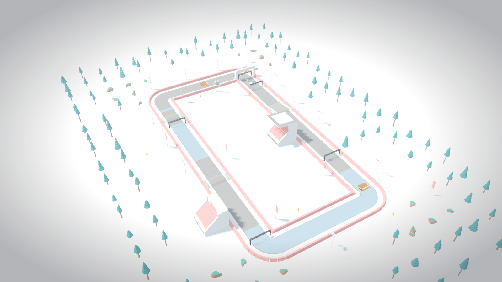
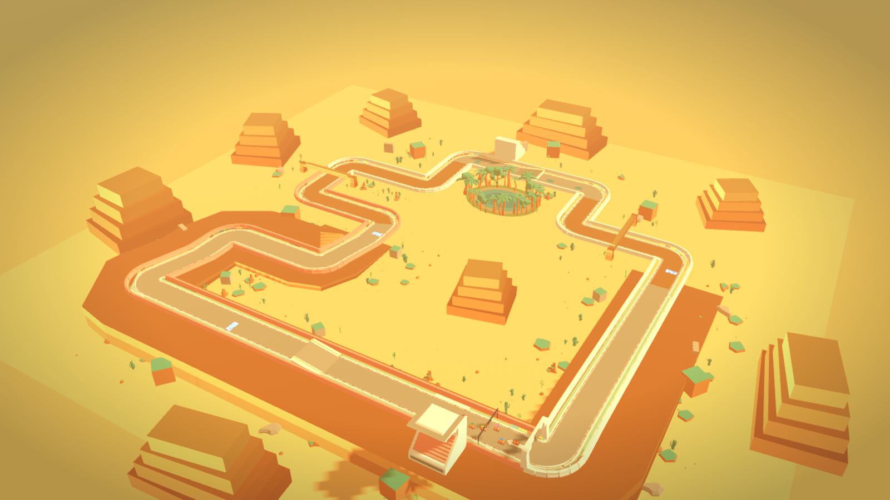
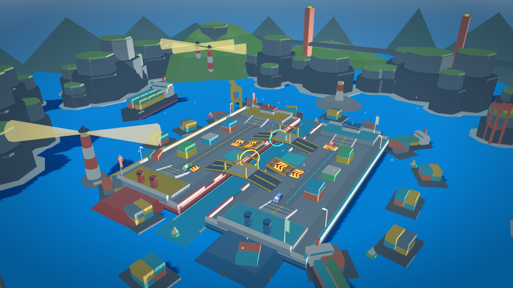
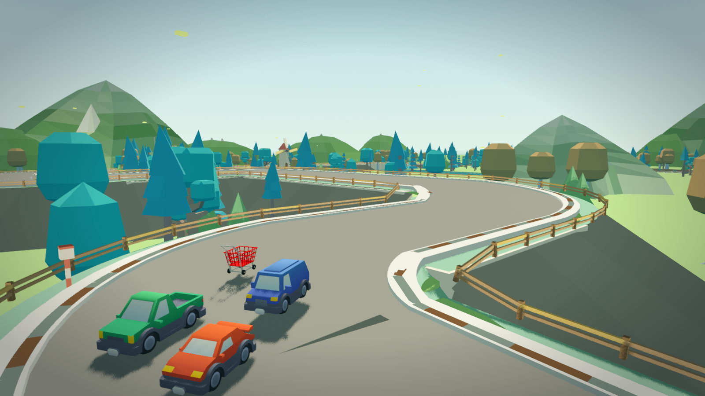
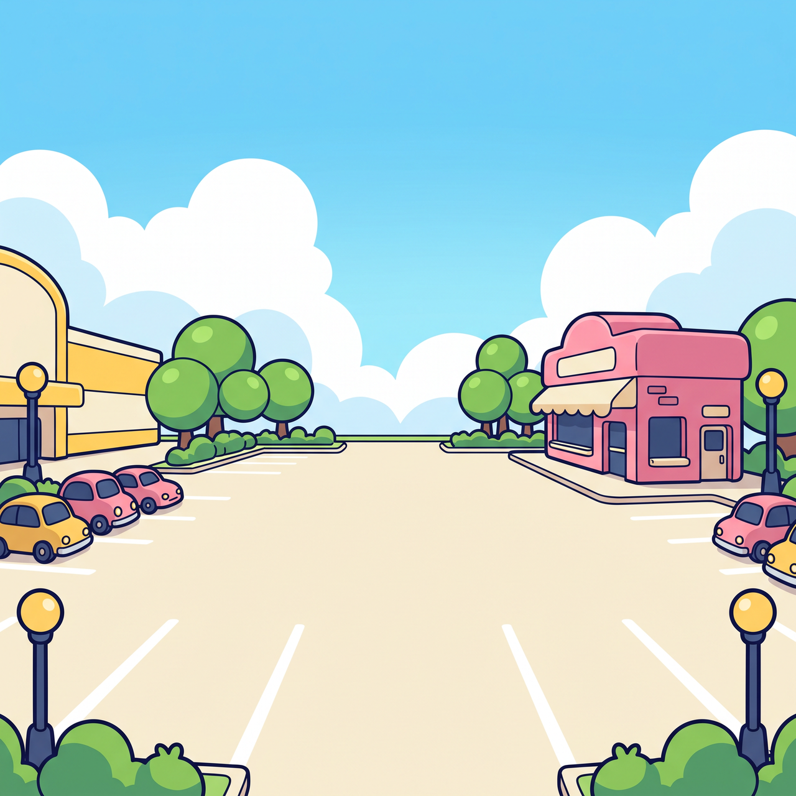
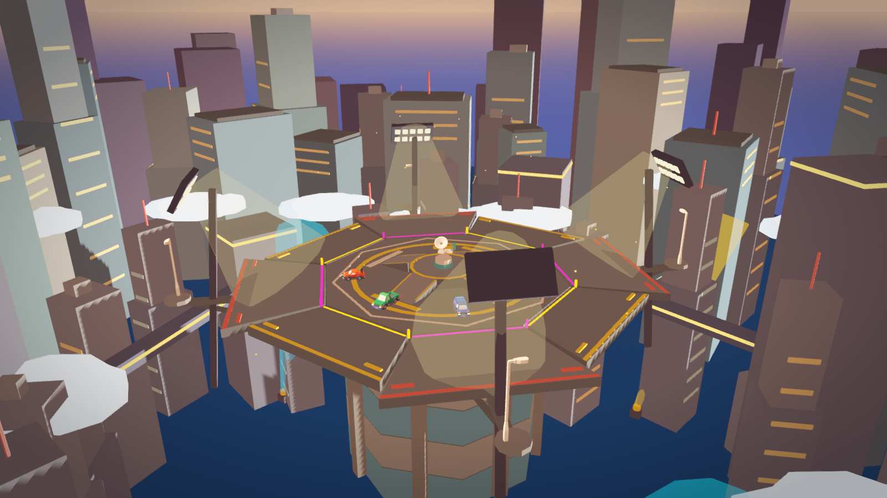
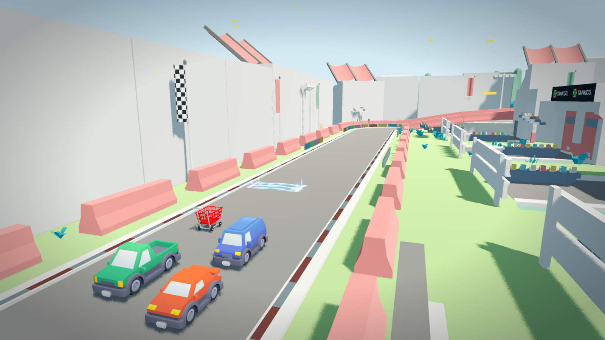

# What's new

Player-facing notes, newest first.

## [0.8.3] - 2026-11-21

### Races always finish now

- **Fixed: 3 laps with no finish.** The anti-cheat lap timer compared your lap against a flat-out top-speed ideal — but boost pads, mini-turbos, and downhill runs can hold a whole lap above top speed, so fast legal laps were thrown out and the race never ended. The floor now allows heavy overspeed, and a fail-safe accepts the lap after repeated full valid crossings: a heuristic can never block progress again.
- **Host loss no longer hangs a match.** If the host disconnects mid-game, Blast Tag, Deliver, and Knockout now conclude locally from the current standings and show results instead of freezing the clock forever.
- **Clients always see the ending.** Deliver no longer drops the reliable match-end when a state snapshot wins the race (late joiners included), carried-crate effects clear on the result card, and Knockout clients re-sync a missed round clock instead of drifting.

## [0.8.2] - 2026-11-20

### macOS multiplayer, LAN discovery and relay

- **macOS 14/15 now gets Local Network permission.** The exported app bundle
  declares `NSLocalNetworkUsageDescription`, so macOS asks for local-network
  access instead of silently blocking every LAN packet (LAN rooms never
  appeared, LAN joins timed out). The room browser and join errors now also
  explain how to allow it under System Settings → Privacy & Security → Local
  Network, and first-run discovery retries through the permission prompt.
- **LAN discovery was rebuilt for multi-homed machines.** Interface picking no
  longer assumes Windows adapter names, so a Mac's `en0`/`utun`/`awdl`/`bridge`
  interfaces are scored correctly; discovery broadcasts over every local
  subnet, replies are ranked by the interface they arrive on, and a host
  advertises the address on the joiner's subnet. Fixes "no rooms found" on
  Macs with a VPN or both Wi-Fi and Ethernet active.
- **Relay connections survive more situations.** IPv6-literal relay addresses
  resolve correctly, a sleep/wake now re-syncs the server clock, drops stale
  keep-alives and reconnects the tunnel, slow tunnel writes can no longer
  corrupt the Pi's framed stream, and TLS/DNS failures are reported as such
  instead of a blanket "server offline".

### Pi server and hosted play

- The HTTPS front end no longer freezes when a browser opens a speculative TCP
  connection (the Safari/Chrome preconnect pattern): each handshake has a
  deadline and its own worker.
- Browsers arriving through the Cloudflare tunnel (all seen as loopback) no
  longer share a tiny connection budget, so one player loading the 140 MB web
  build can't lock everyone else out.
- Every route answers `HEAD` again, percent-encoded room codes resolve, the
  SD-card `install.sh` installs the web export to the right place (and
  `tracks.json`), and TLS certificates are generated as proper leaf certs with
  a `serverAuth` EKU and refreshed SANs for stricter macOS trust.
- New regression coverage: 44 security cases, 91 race-API cases, 6 TLS-proxy
  cases.

### Builds and packaging

- The release script now verifies the real artifacts instead of trusting the
  exporter: macOS `Info.plist` must contain the Local Network key and the
  universal/`arm64`+`x86_64` binary and sealed signature are inspected; the
  embedded data pack is proven from its trailer/header; Linux exec bits, the
  web file set and wasm magic are asserted; Windows gets a headless boot smoke
  test; and `SHA256SUMS` is generated from the exact expected zip set.

### Bug sweep

- Re-ran the whole battery plus extra coverage (undocumented mode self-tests,
  hostile-save/30-case settings probe, 13-case menu/HUD flow probe, end-to-end
  one-lap race) and added the new cross-platform networking regression test.
  No reproducible gameplay regressions were found; the defects fixed here are
  the multiplayer/platform ones above.

### Maps rebuilt: no more clipping, blocking, or washed-out white

- **Mountains can't land on the road anymore.** Every peak, hill, and mesa ring
  now measures its real footprint against the track: the Glacier summit vista
  that swallowed karts, grey default peaks over green valleys, and hillsides
  edging onto the tarmac are all placed clear, smaller where needed, and
  painted in vivid cartoon blues and greens instead of flat grey.
- **Meadow's green roads are gone.** The kerbs are terracotta again and the
  dirt trail paints over bump tiles, so no grey asphalt wedges survive inside
  the brown forest sector.
- **Every blocked ramp now climbs clean.** The Terrace Plaza skywalk abutment
  that stood 1.7 m across the climb is stepped supports; the Labyrinth's
  abutments, the Twin Ferries' wheelhouse fills and gap-kicker supports, and
  the Glacier Bowl's berms were all re-cut to stay under the ramp surface. The
  Ferris wheel no longer straddles the Plaza's corner walls, crates are off
  the Sandbox funbox deck, buried Iceberg kickers are uncovered, and Sandbox
  bots steer down the real kicker centreline.
- **Sculpted detail pass everywhere.** Peaks gain ridgelines, rock ribs, snow
  cornices, and tertiary horns; hills get terraces and summit tors; mesas get
  caprock lips, varnish streaks, and talus boulders; spires get balanced
  boulders; arches get keystones and wing fins. Stadium and Dockyard have
  bespoke skies, and trackside clusters add rubble, snowdrifts, and berry
  bushes — all inside the existing draw budgets.

### Bots that actually race you

- **Blast Tag bots play the mode now.** Hunters lead their target and ram the
  intercept point; runners weave, break sightlines toward ramps, and juke with
  difficulty nerve (Easy panics at 6.5 m, Hard holds until 4.2 m). With nobody
  to chase, both roam arena rally circuits instead of camping a fixed point,
  and a new anti-wall steer stops the old grind-into-the-pillar loops.
- **Difficulty is real in every mode.** Knockout bots pick targets and time
  slams by level, race bots hold boost over launch ramps they detect ahead,
  Deliver bots seek longer and pick smarter, and Sandbox bots play tag —
  chasing down the nearest kart for a bump using the same physics you drive.
- **Same rules as you.** Every bot runs the identical kart controller, boost
  drain, juke cooldowns, and slam activation as a human player. Skill only
  changes aim, anticipation, and patience — never stats.

### Netcode, relay efficiency, and Pi server speed

- **Less bandwidth, same protocol.** Idle karts sync at 5 Hz instead of 20 Hz,
  the tunnel caps runaway buffers with a surfaced reason, flushes to EAGAIN
  with jittered backoff, heartbeats fail fast on dead rooms, LAN beacons
  carry version filters, the clock sync takes a median of 7 samples, and join
  failures finally say *why* (full, in-game, TLS, DNS, timeout) with a hint.
- **The Pi serves faster.** Race ticks run on a deadline with skip-late
  budgets, HTTP workers and queues are bigger with proper 503 + Retry-After,
  the relay drain scales with backlog, keep-alives stop pinning threads, tunnel
  frames coalesce, upstream sockets are shared, TLS resumes sessions, SSE and
  bulk downloads stay off the API threads, and deploys gate on `/api/health`
  with rollback. New perf harness: ~15,000 packets/s relay, sub-millisecond
  ticks, 8 concurrent tunnels, ~23 TLS handshakes/s.

### Also fixed in this pass

- Respawn crash guard, fake best-lap rejection, stale Knockout ghosts that
  could stall a round, bombs stacking on one kart, Deliver hold-starvation and
  finish scoring, Sandbox bot re-seating, roof-perched bots, and the boost
  meter exploit.
- Lap pips light up again, late-join HUDs get ping and scoreboard, the lobby
  fits 960×540, music volume actually routes to the Music bus, and every
  settings field validates before it saves.
- Vehicle outliers rebalanced (orange accel, white top speed, green grip) and
  each race-kit livery gets its own engine voice.

## [0.8.1] - 2026-11-20

### Maps

- **The Sandbox park actually has ground again.** Its custom ground, painted
  zones and raised terrace were wound backwards, so the whole layer was
  back-face culled and the park floated on the sky. Grass, tarmac, the paddock
  apron, the drift bowl and the dirt strip all render now, with proper shadows.
- The stunt park got a visual pass: richer grass and paint tones, staged
  vehicles for its menu card, and a new low-angle hero render used behind the
  main menu.
- **Every party arena's ring of scenery is now built for the arena it decorates**
  instead of assuming flat ground at zero: the Skytop Helipad gets a city
  skyline beneath its pad, the Molten Foundry's stacks stand on the lava sea,
  the Fractured Iceberg's pines grow on ice floes, and the Twin Ferries ring is
  cargo barges floating in the harbour. Rings are spaced so they no longer
  interpenetrate, and stadium-bench rings no longer merge into a solid wall.
- Molten Foundry's steel reads blue-grey against the lava instead of dissolving
  into an orange wash; Skytop's clouds are white again instead of muddy islands.
- Circuit presentation fixes: Redwood Valley's oversized teal "redwood" wall is
  a natural mixed forest that no longer hides the valley, Sunset Canyon's mesa
  shelf has lit rock strata instead of a flat slab, Glacier Pass's giant cuboid
  ridges sit back in the fog, and the dockyard preview no longer looks at the
  blank backs of billboards across a flooded quay.
- Regenerated all 18 menu previews from the live scenes, plus new
  `bg_parking.png` / `bg_arena.png` promotional renders.

### Vehicles and driving

- **Removed per-player vehicle paint tinting.** Every cart, van and truck now
  keeps its factory livery in every mode and every peer; the Garage keeps its
  twelve-point stat tuning. Driver identity is carried by name tags instead.
- Crisper high-speed cornering (steering authority raised at top speed), a
  smoother counter-steer return and stronger braking bite that kills a slide.

### Bots

- Racing bots now notice a wall at crawl speed and reverse out much sooner,
  alternate the side they peel out on when the same wall re-wedges them, reverse
  even when traffic is close rather than staying pinned forever, and ease back
  onto the racing line after a recovery instead of launching into the same
  corner. They also shed a little speed when they run wide so the pursuit
  controller can pull them back without spearing the barrier.

### Interface and artwork

- Changelog entries now carry scene images, and the in-game changelog panel
  renders them.
- Loading and menu artwork is stable while the main-menu slideshow crossfades
  between the new sandbox and helipad renders.

### Verification

- Full headless battery green: map/tile audit, HUD smoke, all map self-tests,
  real-physics driving, vehicle roster, mode rules and the 133-check updater
  suite. All 18 previews pass the preview audit; Windows, macOS, Linux and Web
  exports are rebuilt from this tree.

## [0.8.0] - 2026-11-20

### Driving, vehicles and circuits

- Added the full road-vehicle roster to Racing: shopping carts, vans, trucks and
  specialty vehicles join the race-kit cars, with per-vehicle preview framing.
- Retuned high-speed steering, tyre grip, heavy-vehicle handling, ramp launches,
  air control and collision response for more predictable cornering and jumps.
- Corrected Speed-Up Aurora travel direction and opened scenic gaps in flat
  guardrail straights while retaining corner and elevated-track protection.
- Added dense themed perimeter scenery, animated landmarks and batched weather
  to every circuit and party arena; regenerated all 18 previews from live scenes.

### Bots, party modes and interface

- Added host-replicated Easy, Normal and Hard bot difficulty across Racing,
  Deliver, Knockout, Blast Tag and Sandbox, including genuine zero-bot sessions.
- Improved racing-bot recovery and corner planning. Deliver now targets eight
  crates, respawns cargo more gradually and gives bots human-like loading delays.
- Simplified the racing and party HUDs with modern body typography, lighter
  outlines, flatter parallelogram plates and fewer decorative labels.
- Reworked multiplayer room controls and menu spacing while keeping the
  homescreen artwork stable and removing redundant HUD clutter.

### Verification and updates

- Added real-physics driving, vehicle-roster, multiplayer-rules and 133-check
  updater smoke coverage, including archive hashes, traversal rejection and
  Windows/Linux/macOS installer staging.

### Launch content

- **Knockout (Bumper Royale)**: 2–8 player (+ AI) last-cart-standing brawler.
  Hits build Smash-style **Knockback %** (`0%–250%`), **Power-Slam Surge**
  (`E` / `F` / Right Mouse / Gamepad `B`) delivers heavy shockwave hits, and
  outer platform sectors collapse as the round heats up across **Skytop
  Helipad**, **Molten Foundry**, and **Fractured Iceberg**.
- **Blast Tag (Hot-Potato Chase)**: 2–8 player (+ AI) 2-minute chase with a
  ticking **Mega-Bomb** overhead (`+18%` Carrier Panic Overdrive), **Ram-Pass**
  with a `1.8 s` Cyan Immunity Shield, **Runner Juke Surge** smoke dodges, and
  `0.0 s` detonation shockwaves across **Terrace Plaza**, **Canyon Labyrinth**,
  and **Twin Ferries**.
- **Deliver (Cargo Rush) Overhaul**: Rebuilt from flat retextures into three
  distinct 3D maps — **Harbour Overpass** (`+2.2 m` steel bridge & water
  channels), **Windmill Hills** (`+2.0 m` barn plateau & mud plank bridges),
  and **Glacier Bowl** (sunken slick-ice bowl & snow-berm jump kickers) — with
  faster `0.45 s` crate pickups and `120 s` matches.

### Five longer, high-verticality racing circuits & Speed-Up Aurora

- Added **Sunset Canyon** (`987 m` lap, `12.0 m` mesa climb, sandstone arches,
  canyon oasis) and expanded all circuits to `857–1,050 m` laps with real
  bridges, viaducts, and `7.5–13.5 m` elevation changes (**Stadium Circuit**,
  **Redwood Valley**, **Sunset Canyon**, **Dockyard Quay**, **Glacier Pass**).
- Rebuilt the **Speed-Up Aurora** boost zones with rushing holographic speed
  chevrons, glowing lateral energy rails, tall vertical wisps, and reactive
  surge flashes on trigger.

### Arcade hop-drift, 3-tier mini-turbo & driving feel

- **Hop + Committed Drift**: Tapping handbrake pops a crisp suspension hop into
  a locked drift angle with smooth counter-steer carving instead of slowing you
  down like a foot brake.
- **3-Tier Mini-Turbo**: Hold drifts to charge **SPARK** (cyan), **BLAZE**
  (amber), and **ULTRA!** (magenta) boosts with rear-wheel sparks, tier-up
  chimes, twin exhaust flame cones, 4-gear engine audio, and a `102°` camera
  FOV kick.
- Shopping Cart now supports custom paint colours and Racing Garage stat
  tuning.

### Comic-arcade HUD, cel-shaded key art & centered menus

- Replaced generic shaded HUD boxes with a bold **Slop-Slash Comic-Arcade HUD**
  across Racing, Knockout, Blast Tag, Deliver, and Sandbox: thick-outlined
  display typography, skewed parallelogram slashes, a 14-cell radial
  parallelogram tachometer, standalone 10-cell boost bars, Smash-style `%`
  plates, and a 16-cell slanted loading bar.
- Added crisp cel-shaded widescreen key art and `1600x900` 3D renders for all
  18 circuits, party maps, and modes; eliminated homescreen background/button
  jitter, stripped redundant menu badges, and horizontally centered all menus
  and Garage parallelogram stat bars.

### Server 1.8.0, networking & hardened 1-click auto-updates

- Upgraded the Raspberry Pi relay/web server to **v1.8.0** with custom 3D track
  polylines, Knockout/Blast Tag room events, live console leaderboards, and
  accurate memory reporting.
- Hardened desktop auto-updates with strict HTTPS/LAN origin validation,
  SHA-256 verification on both Pi mirrors and GitHub Releases, stale sidecar
  `.pck` cleanup, and atomic self-replacement on Windows, macOS, and Linux.

## [0.7.3] - 2026-11-17

### Windows players can actually start the game

- The Windows download was two files: `CartSlopGP.exe` plus a large
  `CartSlopGP.pck`. If a player extracted only the executable, moved it to the
  Desktop, or double-clicked the exe straight out of the zip (Windows extracts
  just the exe in that case), the game died with
  **"Couldn't load project data — is the .pck file missing?"** and never opened.
- The data pack is now built into the executable, so the download is one file
  and cannot be broken apart. Linux gets the same treatment, so `chmod +x` and
  run is all it takes there too.
- The build now refuses to publish a Windows or Linux binary whose data pack is
  not embedded, so this cannot ship again.
- Everything in 0.7.2 is included (see below).

## [0.7.2] - 2026-11-17

### Linux players can start the game again

- The Linux download shipped `CartSlopGP.x86_64` without its executable bit, so
  the file extracted unlaunchable and the game never started. The release zip now
  carries proper Unix permissions, and the build checks them before it publishes.

### Driving

- Car-to-car contact exchanges momentum again on a head-on hit. The impulse was
  measured after the physics engine had already separated the pair, so the
  approach speed read as zero and the shove disappeared.
- The impact cooldown after a hit now only gates the shake, hit-stop and sound.
  It used to skip the whole collision pass, so a cart that had just been bumped
  also lost its wall response for a moment.
- The first boost puff after a respawn is no longer swallowed, and landing on the
  grid no longer fires a phantom landing burst.

### Tracks

- A track's grip sectors (the dockyard wet lane, the glacier ice) now come from
  the same map module as the layout and the terrain, so the menu preview and the
  race can no longer disagree about where the surface changes.

### Multiplayer

- Joining a LAN room twice, or joining while already hosting, no longer tears
  down the live session.
- Cancelling a host request no longer leaves the loading overlay stuck over
  every later screen.
- Pings can no longer display a negative or multi-minute value from a stale
  reply, and a new session measures the server clock again instead of reusing
  the previous relay's offset.
- A rejected relay token drops the link and backs off instead of re-sending the
  handshake 60 times a second.

### Updates

- A build published to the Pi mirror is offered even when GitHub is reachable and
  its own latest release is older, which is the documented Pi-first flow.

### Interface

- Left and right arrows flip through the garage, as the screen always claimed.
- The race clock, best lap and speed readout reject corrupt values instead of
  printing garbage, and the standings list holds a full 13-cart field.

## [0.7.1] - 2026-11-14

### The whole game is now built from the Kenney cartoon kits

- Every circuit, the sandbox and Cargo Rush are built from real modular kit
  pieces: road tiles, barriers, grandstands, pit garages, floodlights, flags and
  signage. No more placeholder geometry dressed with photo textures.
- Race maps are authored as a tile grid and must form one closed lap, so the road
  always connects. Seam gaps, height steps and loop closure all measure 0 mm.
- Terrain is no longer flat: stadium climbs 0-6 m with a banked straight, the
  dockyard has a raised wharf and a sunken container lane, and Glacier climbs to
  9 m before a fast descent.
- Trees are placed as designed woodland - clustered, several rows deep, with
  clearings at the grandstands - between 432 and 751 trees per map.

### Driving

- Player collisions conserve momentum: two carts shove each other apart instead
  of one stopping dead, and heavy vehicles push light ones.
- Drifting now costs speed in proportion to how sideways you are, instead of
  carrying almost all your momentum through a corner.
- Brakes are stronger and also kill a slide, so stopping works while drifting.
- Bumps give a brief loss of steering rather than a dead stop, and no cart can
  tunnel through a wall, a crate or another cart at any tick rate.

### Bots

- Bots choose between four racing lines with per-driver braking points, and make
  overtaking and defensive moves.
- Bots ride ramps properly, recover when beached, and never drive through them.

### UI

- One spacing system across every screen, with nothing clipped at 1280x720.
- Settings use real sliders grouped by a single label column; menus use square
  tiles instead of stretched pills, and no divider lines anywhere.
- The speedometer is an arc with the number as the hero; the standings show every
  player; ping has its own corner so it cannot overlap the race order.
- The speed zone is a soft blue aurora field instead of a painted chevron.
- Racing and Deliver are games you pick, then pick a map or arena inside them,
  and the lobby handles both - including team assignment for Deliver.

### Modes

- Deliver: presents are scattered around the arena, hold the interact key for two
  seconds to load one, then carry it home. Teams are Alpha and Beta, and the host
  can move players between them.
- Sandbox is a five zone test facility: paddock, handling loop, skidpad, jump lane
  and a dirt strip.

### Fixes

- Over 40 logic defects found and fixed across every mode, including later
  finishers outranking earlier ones, a present claimed by two players at once, a
  carrier disconnect freezing the crate, settings switches wired backwards, and
  corrupt settings wiping progress instead of recovering.
### Bumps that move you

- Hitting another cart now transfers momentum properly: two karts shove each
  other apart instead of one simply stopping dead.
- A careless hit costs you a moment of steering, not the whole race, and
  clipping a wall or a crate now keeps your speed and slides instead of
  stopping the kart.
- Heavier vehicles push lighter ones around, as you would expect.

### Bots that race

- Race bots follow a real racing line, brake before corners and stop driving
  into tyre walls.
- Bots now ride the dirt ramps instead of passing through them, and they
  recover on their own if they get beached.
- Free-roam bots in the sandbox steer around crates, ramps and other carts.

### A map worth looking at

- The row of dome-shaped hills is gone. Both maps now sit inside layered
  ridges, cliffs and distant peaks.
- The track has grandstands with crowds, a start gantry, tyre walls, marshal
  posts and sponsor boards.
- The park gained a pond, boulders, fencing, a paddock and denser woodland.

### Easier to use

- Menus work properly with a keyboard or gamepad: focus is visible, Escape
  closes only the top panel, and every menu has a way back.
- The HUD shows your gear, current and best lap, the gap to the leader, and
  the real ping to the server.

### Play in your browser

- The Pi can serve the game itself: sign in with the panel password and play
  in the browser, no download.

### Fixes

- The browser build no longer offers an update it cannot install.
- Rubber-banding is gone from bot races.

## [0.7.0] - 2026-11-10

### Races run by the Pi

- The Pi now owns the multiplayer race clock, the official lap and finish
  times, and the standings.
- Bots are simulated by the Pi and streamed to every player, so the whole room
  races the same field.
- If the room server is older than 1.6.0, the game falls back to the previous
  host-run race automatically.

## [0.6.9] - 2026-11-10

### Cleaner racing

- Players now collide with each other online instead of driving through one
  another.
- Bots are simulated by the room host and streamed to every player, so
  everyone races the same rivals on the same line.
- The host's ping now shows the real round trip to the Pi relay instead of a
  hard-coded 0 ms.
- Boxes and cones react on every screen: a client's hit is predicted locally
  and confirmed by the host. Crates now physically block carts.
- Bots no longer ram you off the road. They give you room and lift off when you
  are alongside, while still racing each other hard.
- The OFF TRACK warning only appears once you are past the barrier. A recovery
  puts you back on the road ahead of where you left it, never behind.

## [0.6.8] - 2026-11-10

### Online rooms

- Online rooms connect through the Cart Slop relay again.
- Gameplay is unchanged from 0.6.6.

## [0.6.6] - 2026-11-08

### Settings, rebuilt

- SETTINGS is now one clean panel with AUDIO, VIDEO, GAMEPLAY, ACCESSIBILITY
  and UPDATES sections. Everything fits at 720p.
- QUALITY and BOT DIFFICULTY are explicit cycle buttons, and the switches are
  small and readable instead of giant checkboxes.

### Map select

- The map picker is now **MAP SELECT**, with a larger track preview, one short
  description and just VEHICLE and RACE as actions.

### Curved ground

- The cart uses a capsule body with four wheels, so it follows domes, banks and
  the mesa instead of catching on terrain corners.
- Curbs and low bumpers no longer stop the cart dead.

### Effects and rivals

- Boost and landing kick up warm dust; impacts throw real sparks.
- Bot difficulty changes speed, boost use and cornering, and sandbox bots pick
  different lines instead of driving as one train.

### Online

- Remote carts receive the real vehicle size, finished racers stop being solid,
  and race-state packets carry velocity so side-by-side driving stays smooth.

## [0.6.5] - 2026-11-08

### Faster races

- Collision, AI, the race clock and lap progress run on the fixed 60 Hz physics
  step, so bumps and lap times no longer depend on frame rate.
- Meadow Loop keeps detail where you can see it, and the HUD updates only when
  a number changes.

### Real car shapes

- Every vehicle has its own length, width, height, wheelbase and track.
- Car-to-car contact uses an oriented box instead of a fixed circle, so
  side-by-side cars stop bumping empty air.

### Racing HUD

- One top-left race plaque for position, lap, time and best lap, live standings
  on the right, a segmented boost meter and a compact speedometer.
