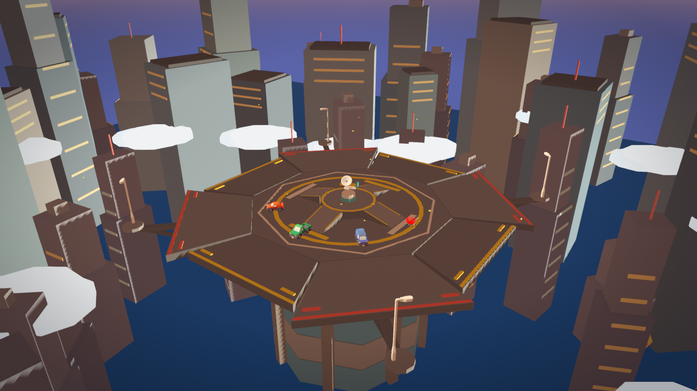
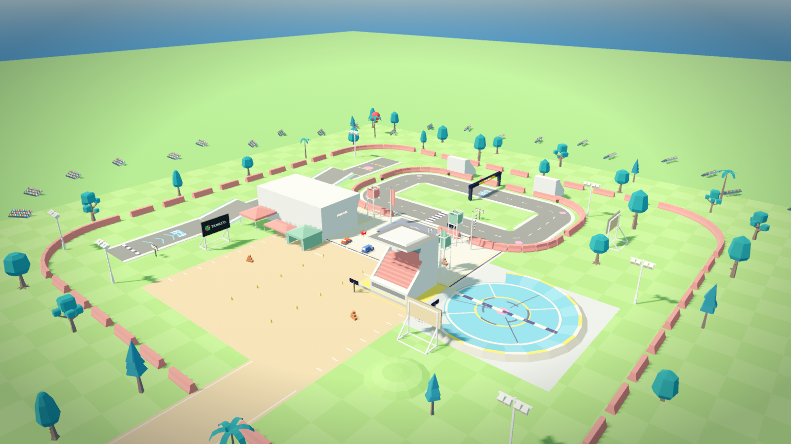
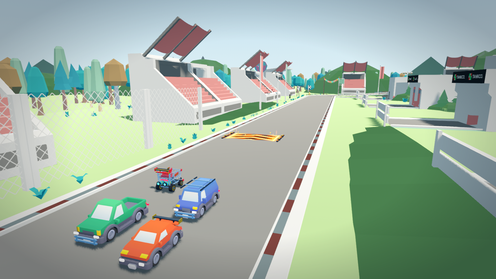

# What's new

Player-facing notes, newest first.

## [0.8.7] - 2026-11-25

### LAN Latency Slashed, One Authoritative Leaderboard, Faster Loads & 100% Slanted UI!

A multiplayer-correctness, latency and load-time release. Same-LAN races now join **directly** instead of relaying through the Pi (the reported **50-70 ms** LAN ping is gone: measured network round trips are **6-7 ms direct** and **~27-34 ms** even when forced through the relay, versus the previous 50-70 ms), every player now sees the **same authoritative final standings**, every race scene builds up to **5x faster**, and every UI screen — including all four multiplayer end cards — is fully unified under the black slanted theme.

#### LAN Latency: 50-70 ms -> 6-7 ms on the Scoreboard

- **Direct-LAN shortcut for online rooms.** When the relay reports that the room's host is on the same local network, the client now tries a direct ENet connection first and only falls back to the Pi relay if the host's firewall blocks it (3 s probe, silent fallback). The ship-breaker: every room used to relay client → Pi → tunnel → host even when both players sat on the same switch, and at 60 fps that path costs about four frame slots per round trip (~66 ms). Direct removes the Pi and two of those slots.
- **Fixed the Cloudflare WARP / public-relay hairpin.** If local discovery missed the Pi, the host used to register through the baked public address; on a machine with WARP up that POST egressed through the VPN and the server recorded an off-LAN host address, so every same-LAN packet took an internet detour. The client now re-points itself at the LAN Pi (verified against `/api/status`) before registering, prefers the room's LAN endpoint when joining, and retries the LAN upgrade every 30 s.
- **Fixed Nagle being left ON for the host tunnel.** `StreamPeerTCP.set_no_delay()` was called before the socket existed, so the engine rejected it and every small state/pong frame could wait a delayed-ACK window (up to ~40 ms). TCP_NODELAY is now applied once the handshake reports CONNECTED.
- **Persistent HTTP keep-alive for all live traffic.** Godot's `HTTPRequest` opens a fresh TCP connection per request, which made a LAN ping probe read 35-48 ms instead of the real ~5 ms, and opened up to ~12 sockets/s with the 10 Hz race-state stream. One persistent connection now carries ping, clock sync, race state and bot polls; the HUD host ping dropped from 35-48 ms to 14-20 ms, and the in-game client ping reads the true path (best-of-window filtering removes frame-quantisation noise).
- **Pi server 1.9.0.** Upgraded and live: fixed a relay PPS-budget refund bug that **dropped ~13% of datagrams** at normal 400-600 packets/s load (ENet then retransmitted, producing exactly the 50-70 ms stall class), refunded unused drain reservations (0% loss under load now), CPU governor pinned to `performance` (HTTP p50 -13%), LAN HTTP accept budget raised so per-request clients no longer get shed, stale headless Godot CI process and 422 MB scratch removed. Measured relay RTT through a registered lobby: p50 **6.75 ms**, p95 **10.86 ms**. Server 1.8.0 and older still work on the old relay path.

#### One Authoritative Leaderboard — Everyone Sees the Same Result

- **Host-authoritative final standings.** Racing used to rank each peer from its own unreliable progress feed and stamp remote finish times with its own race clock, so close finishes could swap places between players' screens, and a dropped final packet could hide a finisher entirely (the result card then waited forever). The host now builds one canonical revisioned standings snapshot (`scripts/net/standings_reconciler.gd`), rebroadcasts it at 1 Hz while anyone is finishing, force-finalises after a 12 s settle, and clients render only the newest accepted revision. Ordering is fully deterministic: finished first, earlier crossing time, greater distance, stable id tie-break.
- **Reliable finish reports.** The local finish is now reported client → host on a reliable channel instead of a single unreliable state packet, so "WAITING FOR 1 PLAYER..." cannot stall a finished race anymore; a final snapshot always reports `ALL PLAYERS FINISHED`.
- **Live position agrees with the result table.** Once the authoritative snapshot exists, the in-race position label and the finish table read the same canonical places, and the `/N` field size can no longer shrink when a peer is slow to send state.
- **Deterministic ties everywhere.** Knockout's final order and the HUD fallback standings now break every tie deterministically (key / name) instead of falling back to Godot's unordered sort, so tied players always see the same order.
- **Car selection sync fixed.** The host's session config and per-peer vehicle loadout push could land after a client had already built its cars from its own Garage. A new idempotent `_net_request_session_sync` re-sends the authoritative config when the link comes up and again on every gameplay scene, so the chosen car, `PRO RACER` paint, racing tune and `PICK OWN`/`SHARED` policy apply reliably in all five modes.

#### Much Faster Race Loads & Stability

- **13.5x faster centreline nearest-point queries.** `GridSpline.plan_distance()` scanned all 402 segments and allocated a Dictionary per call (93.2 µs); the clearance/build paths call it thousands of times per map. A plan-view bucket index with an exact expanding-ring search drops it to 6.9 µs, and a new permanent `SPLINE INDEX` audit compares the indexed answer against a brute-force scan on every map (405 probes each, worst error 0.000000 m) so an index miss can never quietly move a prop onto the road. Real race-scene build times: Stadium `~10.8 s -> ~2.8 s`, Glacier `~13.5 s -> ~2.3 s`, Dockyard `~6.0 s -> ~1.3 s`, Canyon `~6.1 s -> ~1.3 s`, Meadow `~3.8 s -> ~0.8 s`.
- **Repaired the malformed Glacier preview image.** v0.8.6 shipped a 1280x720 file where every generated preview is contractually 1600x900 (the checker was right). Regenerated through the project's own windowed preview renderer: 1600x900, 1265 colours, verified visually.
- **Crash-class hardening.** The ambient world no longer calls `get_viewport().get_camera_3d()` unguarded every frame (same family as the 0.8.6 macOS `EXC_BAD_ACCESS`), and `cart_feedback` caches `DisplayServer.get_name()` instead of allocating a String every frame.

#### 100% Black Slanted UI & Rebuilt Multiplayer End Screens

- **One palette, one shell.** New `UiKit` primitives (`modal_panel`, `apply_scrim`, `row_style`, `banner_style`, `page_title`, `compact_button`) and a shared `SlantedShell` replace the duplicated hand-painted Pause/Settings shells; the legacy cream/rounded fallbacks were removed from `assets/ui/theme.tres` (default Button, CheckButton, sliders, scrollbars, slider fill, toggles, play cards), and every UI scene was re-normalised to the shared spacing/font/scrim contract.
- **All four multiplayer end cards rebuilt** on a shared `ResultScreen` builder: banner + subtitle → telemetry | standings columns → action footer. Racing MP cards are now 1180 px wide with a scrolling standings table capped to the card, so buttons can never leave the 720p safe box; Knockout shows `# / DRIVER / KOs / PTS` plus rounds/survivors and finally gets a MAIN MENU button; Deliver shows team score plates plus the target note; Blast Tag keeps its banner colour semantics with a 5-column table. Button matrix is uniform (host rematch + BACK TO LOBBY + MAIN MENU, client back/menu only) with a closed keyboard/gamepad focus ring.
- **Proof at both resolutions.** A new headless `ui_layout_audit.gd` measures all **56** screens/states plus 6 result-card cases at 1280x720 and 1920x1080: 0 legacy-theme controls, 0 viewport overflows, closed focus ring, exit 0.

#### QoL Backlog for the Next Releases

- **New `docs/QOL_RECOMMENDATIONS.md`** — 35 code-grounded, prioritised quality-of-life, feel, perceived-speed and clarity recommendations (top items: gamepad scoreboard binding, device-aware `[E]`/WASD prompts, waiting-for-players clarity, focus-loss auto-pause, web-build multiplayer gating, first-run briefing, restart-in-place, saved lap records). Nothing in it is implemented in 0.8.7; it is the agreed backlog.

#### Phase 2 Polish Pass: Cartoon Vehicle Feel, Living Worlds, Stream-Chat Lobby & Honest Loading

- **Cartoon vehicle feel & accurate physics** — fixed the Glacier Pass ramp collision/mesh mismatch (the collider crest was 0.68 m against a 2.82 m visible kicker, so karts and the camera drove through the top ~2.1 m; the ramp collider is now measured from the actual ramp mesh across its full visible width and every mass class — 45 kg cart to 3,200 kg truck — clears both 17.35 m chasms and lands cleanly); fixed the inside-out Stadium Circuit seating (41/44 grandstands faced their back wall — now 44/44 face the track, and a full 5-racing-map + 9-arena geometry/collider audit found no other inverted or missing faces); fixed the vehicle hover bug (the body capsule's radius and centre scaled differently, lifting the race car body up to 142 mm — all 8 vehicles now seat exactly on the surface); and added purely-visual cartoon animation — squash-and-stretch, body roll, landing compression and springy suspension flex — for your cart **and** every remote player's cart, derived from replicated state with no extra netcode.
- **Living worlds & expressive effects** — new layered GPU ambient systems with 7 themed palettes: blizzard, spindrift and diamond dust on Glacier; dust sheets, sand grains and sun motes on Canyon; chaff, pollen and straw on the farm; embers, ash and lava glow in the foundry; sea mist, salt spray and feathers on the docks; confetti, motes and sparkle in the stadium; leaves, pollen and petals on the meadow. Wind gusts, turbulence, size/speed/lifetime variance, distance LOD and quality tiers keep it at 3 draws per world on desktop and 2 on Web. Tyre/drift marks are now per-car (caster, street, slick, offroad tread widths, four procedural tread styles, seven surface palettes, batched to **one draw per cart** from two, and shown on remote carts too), and the main menu has its own subtle themed particles.
- **Audio never cuts** — the music player now runs a three-deck pool with equal-power crossfades and retiring envelopes, start-gain-aware fades and scene-keyed transition holds: menu changes, race start/end, pause muffle and music/SFX handoffs all fade smoothly instead of stopping hard.
- **UI/UX overhaul** — button sheen/wipe animations use soft gradient fades instead of hard-line clipping; navigation is de-duplicated (single lobby exit, contextual refresh vs search-again, consistent end-screen button names) and every screen keeps the slanted dark-glass hierarchy; the loading bar is re-weighted through streaming → instantiate → warm-up phases so it rises monotonically and only reaches 100% when gameplay is actually ready (it can no longer stall at 100%); and the lobby now has **synced stream-chat reactions** — `GG!`, `START!`, `LOVE`, `SLOP!` and `HONK!` — rising and fading with per-sender colours, host-relayed to every client with anti-spam limits, and usable with mouse, keyboard (1–5) or gamepad.
- **Phase 2 bug fixes** — multiplayer **RACE AGAIN / PLAY AGAIN** now truly restarts the match on every peer in all four modes (validated restart RPC; room returns to `playing`, no deadlock); close finishes are ordered from the reliable finish report using RTT-compensated times, not packet arrival; `settings.cfg` saves atomically (temp file + rename, with crash recovery) so a power loss can no longer wipe your settings; gamepad users can finally hold **Select/View** for the scoreboard; Web builds hide the dead MULTIPLAYER / QUIT / UPDATE paths and explain what needs the desktop download; solo play auto-pauses when the window loses focus (comfort setting, never in multiplayer); late-joining peers receive the final standings; hosts get a lobby ready/presence gate before starting a match; and a host disconnect mid-match now shows a **HOST DISCONNECTED** overlay that keeps the local standings instead of dumping everyone into a fresh lobby.
- **Server v2.0.0 prepared (deployment pending)** — the repository server source is now 2.0.0: compact JSON + cached status, memoised system telemetry, `gc.freeze()`, a Health admin tab (tick/queue/threads/RSS charts, safety counters, copyable diagnostics), `/play` delivery with one-off gzip siblings, HTTP Range/resume and caching (measured **−29.8%** first-load bytes, wasm **−74%**), and a TLS relay pump that no longer corrupts large transfers. It is wire-compatible with every 0.8.x client and is **not deployed** by this release.

#### Phase 3: Browser Builds That Stay Current, Mapmaker Teaser, Living Backdrops & Real Bot Slots

- **Browser play, rebuilt and kept current** — a dedicated **Web Low-Spec** profile now auto-detects weak browsers (≤4 logical cores, ≤4 GB memory, coarse pointer/mobile UA) and drops to a clean 0.5× 3D scale, 30 fps, 3-step physics catch-up, 1600×900 canvas cap, ETC2-only compressed textures, no MSAA/AA/dynamic shadows and a shorter far plane, while stronger browsers keep the 0.65×/60 fps balanced tier. First-load transfer is now **111.1 MB gzip / 106.5 MB Brotli** (down 33 % from 158.9 MB raw; `index.pck` 120.9 → 98.8 MB and `index.wasm` 37.7 → 7.7 MB Brotli), and the whole static client can be served from a **Cloudflare R2 + CDN Worker** package (versioned immutable paths, `no-store` pointers, Brotli/Gzip negotiation, range/resume, conditional COOP/COEP, correct wasm MIME) while the Pi keeps only the live relay/API. Cloudflare Pages is documented as unusable for this build (25 MiB per-asset limit vs the 121 MB pack) and the upload script refuses it loudly.
- **The web client can never go stale again** — every web export is stamped with `version.json` (game + engine version, build id, per-file SHA-256 and sizes), and the build, staging, deploy and `/play` launcher all verify it: a stale or modified export fails the deploy loudly (0.8 s, before any upload), and the launcher shows the served build plus a red **STALE WEB BUILD** warning if it disagrees. This closes the "live `/play` is still 0.7.1" class of bug for good.
- **Official Cartslop branding everywhere** — a new responsive landing site (navbar/hero/features/footer/downloads) plus the `/play` launcher, its sign-in page, the server console and login pages now all use the official app-icon logo, with generated favicons, apple-touch icons, webmanifest and OpenGraph/Twitter previews derived reproducibly from the game's own `cart_icon.png` (previously the web pages had no icon at all).
- **Main menu gains MAPMAKER (coming soon)** — the hero rail is now **`SINGLEPLAYER` → `MULTIPLAYER` → `MAPMAKER` → `GARAGE`**, rebalanced to four clean tiles. `MAPMAKER` is a greyed-out-but-clickable teaser with a crisp padlock; clicking opens a slanted **`COMING SOON :D`** dialog with an **`OK`** button and fires exactly **one** confetti burst as it opens (skipped under reduced motion).
- **Backdrops have a life of their own** — the menu and lobby backdrops are now independent, self-timed **shuffled slideshows** (random 8-12 s beat per slide, smooth 1.15 s crossfades, a full shuffle bag so a plate never repeats back-to-back, gentle Ken Burns drift), and mouse hover/focus on any button or card can no longer change, freeze or retune them. Button-level hover animations are untouched.
- **Caret polish across every text field** — all text inputs now use one shared style: visible **0.5 s blinking** with a high-contrast `#ffd22e` caret (12-13:1 against the dark fields, up from ~1.1:1), so the cursor never sits dark or idle while you type a name or room code.
- **Lobby: slanted living map preview & chrome-free emotes** — the room's map preview is now a true black-slanted card with a soft textured mask, gloss and title scrim plus a subtle idle sway/tilt/parallax (still cheap, reduced-motion aware). Emotes lost all boxy chrome: **no left colour bar and no parallelogram background** — just bold, vibrant emote text with the sender's name in a smaller line, spawning at randomized safe positions, floating up with a playful wiggle and fading out, still synced to every player and still rate-limited.
- **End screens respect host vs client** — hosts keep `BACK TO LOBBY` + `MAIN MENU` (plus rematch where applicable); non-host players get a concise animated **`Waiting for host...`** status and a single **`LEAVE LOBBY`** action. Leaving an active multiplayer session (Leave Lobby or Main Menu) now asks **"Leave lobby and return to Main Menu?"** with `Cancel` / `Leave` so nobody disconnects by accident. Applied uniformly to Racing, Knockout, Deliver and Blast Tag without touching the authoritative standings data.
- **Bots are real lobby slots now** — the 8 lobby seats are shared between humans and bots: a room with 3 bots allows 5 humans, enforced by the host's admission (clear refusal message instead of "host ended the session") and by the prepared 2.0.0 server's capacity fields. Active bots appear in the roster as **`BOT 1`…`BOT 5`** with a robot icon, the host can move individual bots between ALPHA/BETA exactly like humans, Auto-Arrange/Auto-Balance distributes humans and bots together, and every peer sees the identical roster/team state (late joiners included). Existing builds keep talking to each other: the session-config RPC keeps its original arity and bot teams travel on a separate additive RPC with a deterministic fallback.
- **Phase 3 second-pass fixes** — a host loss during a match load now keeps the **HOST DISCONNECTED** overlay and cancels the pending match instead of dropping players into a sessionless race; the scene loader's queue is priority-aware so a local menu click can no longer override an in-flight authoritative match load; the loading overlay releases the outgoing screen's GUI focus (and lobby handlers are gated while it is up); losing the session mid-load aborts the match with a clear notice instead of starting it offline; a failed scene change rolls the room back to the lobby instead of advertising `playing`; the result-card leave confirmation now truly blocks the pause menu's ESC handler while open; multiplayer pause shows the proper "the world keeps racing" hint again; version-gated joins reject mismatched builds with a clear message; and a pre-existing lobby load error (emote buttons fitting text outside the tree) is gone.

#### Verification

All 12 headless suites pass (exit 0), including the `SPLINE INDEX` audit and the netcode standings/LAN-route checks; the UI layout audit measures **70 screens/states with 0 failures** at 1280×720 and 1920×1080 (**76** with the live mode-card variant); the two-process LAN end-to-end, lobby-reaction sync and multiplayer-rematch e2e tests all pass host + client, and Phase 3 adds a **299-assertion bot/slot/team harness** with a **4-process LAN e2e** (3 humans + 5 bots = 8/8, identical roster/team fingerprints, a 9th human refused), **116-check** and **168/192-check** UI harnesses, an **84/91-check** second-pass smoke covering the host-loss/queue/focus/session-teardown fixes, an **11/11 version-parity E2E** (stale web exports refused before upload), **154/154** Cloudflare-package validations, **26/26** mock-edge deploy checks, an **80/80 logo-parity audit**, and forced-Web Low/Balanced boot checks — every one green, with **zero `SCRIPT ERROR` / `Parse Error` lines** across 63 scanned logs. The Pi-side Python suites pass (security 46/46, race API 102/102, TLS 8/8), and the live Pi relay path was re-verified before its nightly window (same-LAN direct join, in-game ping 6–7 ms). The full headless suite runtime stays at ~54 s on this machine.

## [0.8.6] - 2026-11-25

### Glacier Pass Alpine Overhaul, Full Slanted UI Unification & macOS Crash Fix!

A packed polish, visual overhaul, and stability release fixing the macOS ARM-64 crash, unifying **every** UI screen (including Room Browser, Pause, Settings, Multiplayer, and all 4 Game-End screens) under the dark-glass slanted parallelogram theme, and rebuilding **Glacier Pass** into a dramatic cliffside winter-night mountain course!

#### Critical macOS & Release-Build Crash Fix
- **Fixed macOS ARM-64 `EXC_BAD_ACCESS (0x450)` Crash:** Diagnosed the exact release-build null-pointer dereference inside `Viewport::set_input_as_handled()` triggered when pressing `ESC` or backing out of a menu during a scene transition. Every input handler and viewport query across the entire UI and gameplay codebase now consumes input safely before scene swaps and guards against null viewports.
- **Zero-Warning macOS Universal Bundle:** Added `NSSupportsAutomaticGraphicsSwitching` and bundle copyright metadata, re-synced all imports cleanly, and verified the signed Universal Mach-O (`arm64` + `x86_64`) package.

#### Glacier Pass — Complete 3D Alpine Night Overhaul & Twin Chasm Jumps
- **Dramatic 1,813 m Cliffside Mountain Circuit:** Rebuilt Glacier Pass into a sprawling alpine pass (`1.5 m`–`13.5 m` elevation) flanked by a continuous sculpted **3D ridged-multifractal alpine mountain range** (`104 × 92` mesh) with snow-capped peaks, frosted granite crags, valley pine forests, and strict road clearance — zero intersecting mountains or 2D cutouts.
- **Twin Broken-Bridge Cliff Chasm Jumps:** Added two physical & visual **17.35 m broken-bridge crevasses** framed with splintered timber, stone abutments, hazard chevrons, and glowing turquoise ice abysses, powered by **weight-balanced launch physics** (tuned from the `45 kg` Shopping Cart up to the `3,200 kg` Box Truck) plus a fair setback if you miss the jump.
- **Luminous Winter-Night Lighting & Multi-Tone Snow:** Fixed inverted ground winding so the snow valley glows cleanly under the midnight aurora sky (`#04081a`), added opposite cool-blue aurora fill lighting so shadowed mountain faces stay rich frosted blue instead of pitch black, and upgraded glacier crystals to 6-sided faceted sapphire-cyan spires.

#### 100% Slanted Dark-Glass UI Unification & Multiplayer End-Screen Fixes
- **Refreshed Room Browser & Every Modal:** Rebuilt the **Room Browser** (LAN + Online), **Pause Menu**, **Settings Menu**, **Update Dialog**, **Changelog Viewer**, and **Play Menu** in the cohesive 0.8.6 dark-glass slanted-parallelogram theme with crisp slanted outer borders, slanted inputs, slanted room rows, and slanted focus halos across **every** screen.
- **Overhauled All 4 Game-End Screens & Multiplayer Rematch Flow:** Updated **Racing**, **Knockout**, **Deliver**, and **Blast Tag** match result cards from the legacy cream boxes to sleek slanted dark-glass telemetry cards with high-contrast standings, fixed readable lobby server-status badges, and gave **multiplayer hosts** a working **`RACE AGAIN` / `PLAY AGAIN`** rematch button in Racing and Deliver alongside `BACK TO LOBBY` and `MAIN MENU`.

## [0.8.5] - 2026-11-21

### The Grand Spectacle Overhaul: New Racing-Sim UI, Living Worlds, Full 6-Track OST & Multiplayer Vehicle Freedom!

Our biggest visual, audio, UX, and multiplayer polish update yet — rebuilding **Cart Slop GP** from the boot splash all the way to the checkered flag!

#### Brand-New Slanted Racing-Sim UI, Studio Art & Universal Navigation
- **Complete UI Redesign:** Rebuilt the Main Menu, Mode & Map Selector, Multiplayer Lobby, Settings, and Garage into a cohesive, punchy **slanted-parallelogram racing-sim UI** with crisp high-contrast typography, true parallelogram-clipped map previews, live-crossfading studio key art, staggered slide/fade transitions, diagonal sheen sweeps, and tactile click/confirm audio — zero clutter, zero overflow.
- **Crisp Curved-Corner App Icon:** Brand-new clean, high-contrast squircle shopping-cart app icon that stays razor-sharp on desktop docks, taskbars, and macOS Launchpad.
- **Full `WASD` + Arrow Navigation & Universal `ESC` Back-Out:** Navigate every single menu, slider, tab, and lobby control with `WASD` just like Arrow Keys (without ever interfering with typing your name or room code), and hit `ESC` on **any** screen or overlay to cleanly back out.
- **Rethought In-Game Combat & `[E]` Ability Dock:** Replaced the cluttered bottom row in Knockout, Blast Tag, and Deliver with a sleek bottom-center **Combat & Ability Dock** displaying a glowing `[E]` radial/bar recharge ring for **Power-Slam Surge**, **Juke Surge**, and **Crate Load** alongside your Knockback % or Bomb Fuse right where your eyes already are.

#### Concept-Art Worlds Made Real Across Every Mode

- **Northern Lights, Real Lantern Glow & Fluid Biome Blending:** Brought our concept art into 3D with animated emerald-cyan-violet **Northern Lights** aurora skies (`aurora_sky.gdshader`), real warm golden **lantern floor glow pools** (`lantern_pool.gdshader` + budgeted point lights), luminous turquoise ice crystal clusters, sweeping checkered Grand Prix tunnel arches, sandstone Canyon sky-arches, festival pennant garlands, orbiting SlopMart blimp, spinning wind turbines, and smooth multi-region **biome-blended ground shaders** (`biome_blend_ground.gdshader`) with zero harsh seams.
- **Extensive Worlds Across Knockout, Blast Tag & Deliver:** Removed stray floating arena rings, fixed every backwards stadium bleacher across the entire game, and dressed all 9 non-racing arenas with layered mid-field districts and sweeping far-horizon silhouettes so every arena feels embedded inside a living world.
- **Solar Orange-Gold Speed Pads & Forward Chevrons:** Replaced confusing blue pads and inverted arrows with unmistakably forward-pointing warm gold guide chevrons and solar orange-gold nitro boost strips, plus freshly re-rendered **18/18 live map previews**.

#### Hero Turbo Shopping Cart, Unified `PRO RACER` Paint Shop & Sleek Particles
- **Hero Turbo Shopping Cart:** Completely rebuilt the iconic Shopping Cart with a chrome tubular frame, wire lattice basket, oversized gold-rimmed slicks, carbon GT wing, LED headlights, swaying pennant, and **coaxially aligned twin rear nitro thrusters** with matching exhaust flames.
- **Unified `PRO RACER` with 8-Color Live Paint Shop:** Combined the 4 separate racer color variants into one sleek **`PRO RACER`** with an 8-swatch **Paint Color** selector right inside the full-screen 3D Neon Garage Showroom (repaints live with glossy clearcoat automotive paint and syncs across multiplayer!).
- **Cooler, Non-Distracting Particle Effects:** Upgraded drift sparks into crisp stretched world-space metallic spark streaks and added sleek **Nitro Ember Trails** streaming off your thrusters during boosts without obscuring the road ahead.

#### Multiplayer Vehicle Freedom (`PICK OWN` vs `SHARED`) & Sync Overhaul
- **Host Room Vehicle Policy (`PICK OWN` | `SHARED`):** Hosts can now flip any multiplayer room right from the Lobby between **PICK OWN** (both host and every client can open **GARAGE** in **every** mode — including tweaking their own car, `PRO RACER` paint color, and 4-stat Racing Tune!) and **SHARED** (everyone drives the host's car and tune for pure equal-machinery showdowns).
- **100% Unified Vehicle Sync Across All 5 Modes:** Fixed inconsistent remote vehicle syncing across Racing, Deliver, Knockout, Blast Tag, and Sandbox — every player's chosen car, custom paint color, physics mass, collision footprint, and racing tune now sync cleanly on both host and clients, with live car badges right in the lobby roster.
- **Sleeker Multiplayer Nametags:** Resized overhead 3D player nametags so they stay crisp and easy to spot without blocking your view of tight corners or brawls.

#### Full 6-Track Mastered Soundtrack & Smooth DJ Crossfades
- **6 Custom-Mastered Mode Tracks:** Added dedicated mastered OGG Vorbis tracks (`-14 LUFS`, silence-trimmed) for **Menu**, **Racing**, **Sandbox**, **Knockout**, **Deliver**, and **Blast Tag**.
- **Seamless Audio Transitions:** Upgraded `MusicPlayer` with equal-power crossfading, 4-second DJ self-loop blending, smooth transitional low-pass sweeps between scenes, subtle pause-menu muffling, and menu-position resume memory.

#### Bug Fixes & Rock-Solid Reliability

- **Fixed Sandbox Floor-Phasing Spawn Bug:** Thickened the Sandbox ground slab (`24 m`), added an infinite `WorldBoundaryShape3D` safety plane, raised spawn clearance (`y = 0.45`), zeroed initial spawn velocity, and added a floor-rescue watchdog so carts never phase through the floor on load.
- **Server, Auto-Update & All-Platform Verification:** Verified all 135 Python Pi server race-API & security checks, updated the auto-update manifest & release packaging across **Windows**, **macOS Universal**, **Linux**, and **Web**, and reorganized workspace documentation cleanly.

## [0.8.4] - 2026-11-21

### Multiplayer room sync & controlled drifting

- **Fixed: multiplayer racing rooms where only the host loaded.** Fixed a relay tunnel client-ID filter that blocked second and reconnecting clients, fixed scene-ready handshakes during scene transitions so every player enters the grid and starts the countdown together, and added fast 0.8–1.0 s ready/start retries across Race, Knockout, Deliver, Blast Tag, and Sandbox.
- **Full 31-bit peer ID & server race sync.** Updated the Pi server (`/api/race/pos`, `/api/race/lap`, and race history), team assignments, and direct UDP relay sockets so every client's live positions, lap times, and team colours sync cleanly, and hardened server-race countdowns against wall-clock skew.
- **Crisp, controlled drifting in Knockout & Racing.** Eliminated excessive sideways drift sliding by tightening committed drift slip angles, capping lateral drift velocity, preventing sideways knockback from feeding into drift speed, improving counter-steer authority, and boosting lateral grip recovery.

## [0.8.3] - 2026-11-21

### Races always finish now

- **Fixed: 3 laps with no finish.** The anti-cheat lap timer compared your lap against a flat-out top-speed ideal — but boost pads, mini-turbos, and downhill runs can hold a whole lap above top speed, so fast legal laps were thrown out and the race never ended. The floor now allows heavy overspeed, and a fail-safe accepts the lap after repeated full valid crossings: a heuristic can never block progress again.
- **Host loss no longer hangs a match.** If the host disconnects mid-game, Blast Tag, Deliver, and Knockout now conclude locally from the current standings and show results instead of freezing the clock forever.
- **Clients always see the ending.** Deliver no longer drops the reliable match-end when a state snapshot wins the race (late joiners included), carried-crate effects clear on the result card, and Knockout clients re-sync a missed round clock instead of drifting.

## [0.8.2] - 2026-11-20

### macOS multiplayer, LAN discovery and relay

- **macOS 14/15 now gets Local Network permission.** The exported app bundle
  declares `NSLocalNetworkUsageDescription`, so macOS asks for local-network
  access instead of silently blocking every LAN packet (LAN rooms never
  appeared, LAN joins timed out). The room browser and join errors now also
  explain how to allow it under System Settings → Privacy & Security → Local
  Network, and first-run discovery retries through the permission prompt.
- **LAN discovery was rebuilt for multi-homed machines.** Interface picking no
  longer assumes Windows adapter names, so a Mac's `en0`/`utun`/`awdl`/`bridge`
  interfaces are scored correctly; discovery broadcasts over every local
  subnet, replies are ranked by the interface they arrive on, and a host
  advertises the address on the joiner's subnet. Fixes "no rooms found" on
  Macs with a VPN or both Wi-Fi and Ethernet active.
- **Relay connections survive more situations.** IPv6-literal relay addresses
  resolve correctly, a sleep/wake now re-syncs the server clock, drops stale
  keep-alives and reconnects the tunnel, slow tunnel writes can no longer
  corrupt the Pi's framed stream, and TLS/DNS failures are reported as such
  instead of a blanket "server offline".

### Pi server and hosted play

- The HTTPS front end no longer freezes when a browser opens a speculative TCP
  connection (the Safari/Chrome preconnect pattern): each handshake has a
  deadline and its own worker.
- Browsers arriving through the Cloudflare tunnel (all seen as loopback) no
  longer share a tiny connection budget, so one player loading the 140 MB web
  build can't lock everyone else out.
- Every route answers `HEAD` again, percent-encoded room codes resolve, the
  SD-card `install.sh` installs the web export to the right place (and
  `tracks.json`), and TLS certificates are generated as proper leaf certs with
  a `serverAuth` EKU and refreshed SANs for stricter macOS trust.
- New regression coverage: 44 security cases, 91 race-API cases, 6 TLS-proxy
  cases.

### Builds and packaging

- The release script now verifies the real artifacts instead of trusting the
  exporter: macOS `Info.plist` must contain the Local Network key and the
  universal/`arm64`+`x86_64` binary and sealed signature are inspected; the
  embedded data pack is proven from its trailer/header; Linux exec bits, the
  web file set and wasm magic are asserted; Windows gets a headless boot smoke
  test; and `SHA256SUMS` is generated from the exact expected zip set.

### Bug sweep

- Re-ran the whole battery plus extra coverage (undocumented mode self-tests,
  hostile-save/30-case settings probe, 13-case menu/HUD flow probe, end-to-end
  one-lap race) and added the new cross-platform networking regression test.
  No reproducible gameplay regressions were found; the defects fixed here are
  the multiplayer/platform ones above.

### Maps rebuilt: no more clipping, blocking, or washed-out white

- **Mountains can't land on the road anymore.** Every peak, hill, and mesa ring
  now measures its real footprint against the track: the Glacier summit vista
  that swallowed karts, grey default peaks over green valleys, and hillsides
  edging onto the tarmac are all placed clear, smaller where needed, and
  painted in vivid cartoon blues and greens instead of flat grey.
- **Meadow's green roads are gone.** The kerbs are terracotta again and the
  dirt trail paints over bump tiles, so no grey asphalt wedges survive inside
  the brown forest sector.
- **Every blocked ramp now climbs clean.** The Terrace Plaza skywalk abutment
  that stood 1.7 m across the climb is stepped supports; the Labyrinth's
  abutments, the Twin Ferries' wheelhouse fills and gap-kicker supports, and
  the Glacier Bowl's berms were all re-cut to stay under the ramp surface. The
  Ferris wheel no longer straddles the Plaza's corner walls, crates are off
  the Sandbox funbox deck, buried Iceberg kickers are uncovered, and Sandbox
  bots steer down the real kicker centreline.
- **Sculpted detail pass everywhere.** Peaks gain ridgelines, rock ribs, snow
  cornices, and tertiary horns; hills get terraces and summit tors; mesas get
  caprock lips, varnish streaks, and talus boulders; spires get balanced
  boulders; arches get keystones and wing fins. Stadium and Dockyard have
  bespoke skies, and trackside clusters add rubble, snowdrifts, and berry
  bushes — all inside the existing draw budgets.

### Bots that actually race you

- **Blast Tag bots play the mode now.** Hunters lead their target and ram the
  intercept point; runners weave, break sightlines toward ramps, and juke with
  difficulty nerve (Easy panics at 6.5 m, Hard holds until 4.2 m). With nobody
  to chase, both roam arena rally circuits instead of camping a fixed point,
  and a new anti-wall steer stops the old grind-into-the-pillar loops.
- **Difficulty is real in every mode.** Knockout bots pick targets and time
  slams by level, race bots hold boost over launch ramps they detect ahead,
  Deliver bots seek longer and pick smarter, and Sandbox bots play tag —
  chasing down the nearest kart for a bump using the same physics you drive.
- **Same rules as you.** Every bot runs the identical kart controller, boost
  drain, juke cooldowns, and slam activation as a human player. Skill only
  changes aim, anticipation, and patience — never stats.

### Netcode, relay efficiency, and Pi server speed

- **Less bandwidth, same protocol.** Idle karts sync at 5 Hz instead of 20 Hz,
  the tunnel caps runaway buffers with a surfaced reason, flushes to EAGAIN
  with jittered backoff, heartbeats fail fast on dead rooms, LAN beacons
  carry version filters, the clock sync takes a median of 7 samples, and join
  failures finally say *why* (full, in-game, TLS, DNS, timeout) with a hint.
- **The Pi serves faster.** Race ticks run on a deadline with skip-late
  budgets, HTTP workers and queues are bigger with proper 503 + Retry-After,
  the relay drain scales with backlog, keep-alives stop pinning threads, tunnel
  frames coalesce, upstream sockets are shared, TLS resumes sessions, SSE and
  bulk downloads stay off the API threads, and deploys gate on `/api/health`
  with rollback. New perf harness: ~15,000 packets/s relay, sub-millisecond
  ticks, 8 concurrent tunnels, ~23 TLS handshakes/s.

### Also fixed in this pass

- Respawn crash guard, fake best-lap rejection, stale Knockout ghosts that
  could stall a round, bombs stacking on one kart, Deliver hold-starvation and
  finish scoring, Sandbox bot re-seating, roof-perched bots, and the boost
  meter exploit.
- Lap pips light up again, late-join HUDs get ping and scoreboard, the lobby
  fits 960×540, music volume actually routes to the Music bus, and every
  settings field validates before it saves.
- Vehicle outliers rebalanced (orange accel, white top speed, green grip) and
  each race-kit livery gets its own engine voice.

## [0.8.1] - 2026-11-20

### Maps

- **The Sandbox park actually has ground again.** Its custom ground, painted
  zones and raised terrace were wound backwards, so the whole layer was
  back-face culled and the park floated on the sky. Grass, tarmac, the paddock
  apron, the drift bowl and the dirt strip all render now, with proper shadows.
- The stunt park got a visual pass: richer grass and paint tones, staged
  vehicles for its menu card, and a new low-angle hero render used behind the
  main menu.
- **Every party arena's ring of scenery is now built for the arena it decorates**
  instead of assuming flat ground at zero: the Skytop Helipad gets a city
  skyline beneath its pad, the Molten Foundry's stacks stand on the lava sea,
  the Fractured Iceberg's pines grow on ice floes, and the Twin Ferries ring is
  cargo barges floating in the harbour. Rings are spaced so they no longer
  interpenetrate, and stadium-bench rings no longer merge into a solid wall.
- Molten Foundry's steel reads blue-grey against the lava instead of dissolving
  into an orange wash; Skytop's clouds are white again instead of muddy islands.
- Circuit presentation fixes: Redwood Valley's oversized teal "redwood" wall is
  a natural mixed forest that no longer hides the valley, Sunset Canyon's mesa
  shelf has lit rock strata instead of a flat slab, Glacier Pass's giant cuboid
  ridges sit back in the fog, and the dockyard preview no longer looks at the
  blank backs of billboards across a flooded quay.
- Regenerated all 18 menu previews from the live scenes, plus new
  `bg_parking.png` / `bg_arena.png` promotional renders.

### Vehicles and driving

- **Removed per-player vehicle paint tinting.** Every cart, van and truck now
  keeps its factory livery in every mode and every peer; the Garage keeps its
  twelve-point stat tuning. Driver identity is carried by name tags instead.
- Crisper high-speed cornering (steering authority raised at top speed), a
  smoother counter-steer return and stronger braking bite that kills a slide.

### Bots

- Racing bots now notice a wall at crawl speed and reverse out much sooner,
  alternate the side they peel out on when the same wall re-wedges them, reverse
  even when traffic is close rather than staying pinned forever, and ease back
  onto the racing line after a recovery instead of launching into the same
  corner. They also shed a little speed when they run wide so the pursuit
  controller can pull them back without spearing the barrier.

### Interface and artwork

- Changelog entries now carry scene images, and the in-game changelog panel
  renders them.
- Loading and menu artwork is stable while the main-menu slideshow crossfades
  between the new sandbox and helipad renders.

### Verification

- Full headless battery green: map/tile audit, HUD smoke, all map self-tests,
  real-physics driving, vehicle roster, mode rules and the 133-check updater
  suite. All 18 previews pass the preview audit; Windows, macOS, Linux and Web
  exports are rebuilt from this tree.

## [0.8.0] - 2026-11-20

### Driving, vehicles and circuits

- Added the full road-vehicle roster to Racing: shopping carts, vans, trucks and
  specialty vehicles join the race-kit cars, with per-vehicle preview framing.
- Retuned high-speed steering, tyre grip, heavy-vehicle handling, ramp launches,
  air control and collision response for more predictable cornering and jumps.
- Corrected Speed-Up Aurora travel direction and opened scenic gaps in flat
  guardrail straights while retaining corner and elevated-track protection.
- Added dense themed perimeter scenery, animated landmarks and batched weather
  to every circuit and party arena; regenerated all 18 previews from live scenes.

### Bots, party modes and interface

- Added host-replicated Easy, Normal and Hard bot difficulty across Racing,
  Deliver, Knockout, Blast Tag and Sandbox, including genuine zero-bot sessions.
- Improved racing-bot recovery and corner planning. Deliver now targets eight
  crates, respawns cargo more gradually and gives bots human-like loading delays.
- Simplified the racing and party HUDs with modern body typography, lighter
  outlines, flatter parallelogram plates and fewer decorative labels.
- Reworked multiplayer room controls and menu spacing while keeping the
  homescreen artwork stable and removing redundant HUD clutter.

### Verification and updates

- Added real-physics driving, vehicle-roster, multiplayer-rules and 133-check
  updater smoke coverage, including archive hashes, traversal rejection and
  Windows/Linux/macOS installer staging.

### Launch content

- **Knockout (Bumper Royale)**: 2–8 player (+ AI) last-cart-standing brawler.
  Hits build Smash-style **Knockback %** (`0%–250%`), **Power-Slam Surge**
  (`E` / `F` / Right Mouse / Gamepad `B`) delivers heavy shockwave hits, and
  outer platform sectors collapse as the round heats up across **Skytop
  Helipad**, **Molten Foundry**, and **Fractured Iceberg**.
- **Blast Tag (Hot-Potato Chase)**: 2–8 player (+ AI) 2-minute chase with a
  ticking **Mega-Bomb** overhead (`+18%` Carrier Panic Overdrive), **Ram-Pass**
  with a `1.8 s` Cyan Immunity Shield, **Runner Juke Surge** smoke dodges, and
  `0.0 s` detonation shockwaves across **Terrace Plaza**, **Canyon Labyrinth**,
  and **Twin Ferries**.
- **Deliver (Cargo Rush) Overhaul**: Rebuilt from flat retextures into three
  distinct 3D maps — **Harbour Overpass** (`+2.2 m` steel bridge & water
  channels), **Windmill Hills** (`+2.0 m` barn plateau & mud plank bridges),
  and **Glacier Bowl** (sunken slick-ice bowl & snow-berm jump kickers) — with
  faster `0.45 s` crate pickups and `120 s` matches.

### Five longer, high-verticality racing circuits & Speed-Up Aurora

- Added **Sunset Canyon** (`987 m` lap, `12.0 m` mesa climb, sandstone arches,
  canyon oasis) and expanded all circuits to `857–1,050 m` laps with real
  bridges, viaducts, and `7.5–13.5 m` elevation changes (**Stadium Circuit**,
  **Redwood Valley**, **Sunset Canyon**, **Dockyard Quay**, **Glacier Pass**).
- Rebuilt the **Speed-Up Aurora** boost zones with rushing holographic speed
  chevrons, glowing lateral energy rails, tall vertical wisps, and reactive
  surge flashes on trigger.

### Arcade hop-drift, 3-tier mini-turbo & driving feel

- **Hop + Committed Drift**: Tapping handbrake pops a crisp suspension hop into
  a locked drift angle with smooth counter-steer carving instead of slowing you
  down like a foot brake.
- **3-Tier Mini-Turbo**: Hold drifts to charge **SPARK** (cyan), **BLAZE**
  (amber), and **ULTRA!** (magenta) boosts with rear-wheel sparks, tier-up
  chimes, twin exhaust flame cones, 4-gear engine audio, and a `102°` camera
  FOV kick.
- Shopping Cart now supports custom paint colours and Racing Garage stat
  tuning.

### Comic-arcade HUD, cel-shaded key art & centered menus

- Replaced generic shaded HUD boxes with a bold **Slop-Slash Comic-Arcade HUD**
  across Racing, Knockout, Blast Tag, Deliver, and Sandbox: thick-outlined
  display typography, skewed parallelogram slashes, a 14-cell radial
  parallelogram tachometer, standalone 10-cell boost bars, Smash-style `%`
  plates, and a 16-cell slanted loading bar.
- Added crisp cel-shaded widescreen key art and `1600x900` 3D renders for all
  18 circuits, party maps, and modes; eliminated homescreen background/button
  jitter, stripped redundant menu badges, and horizontally centered all menus
  and Garage parallelogram stat bars.

### Server 1.8.0, networking & hardened 1-click auto-updates

- Upgraded the Raspberry Pi relay/web server to **v1.8.0** with custom 3D track
  polylines, Knockout/Blast Tag room events, live console leaderboards, and
  accurate memory reporting.
- Hardened desktop auto-updates with strict HTTPS/LAN origin validation,
  SHA-256 verification on both Pi mirrors and GitHub Releases, stale sidecar
  `.pck` cleanup, and atomic self-replacement on Windows, macOS, and Linux.

## [0.7.3] - 2026-11-17

### Windows players can actually start the game

- The Windows download was two files: `CartSlopGP.exe` plus a large
  `CartSlopGP.pck`. If a player extracted only the executable, moved it to the
  Desktop, or double-clicked the exe straight out of the zip (Windows extracts
  just the exe in that case), the game died with
  **"Couldn't load project data — is the .pck file missing?"** and never opened.
- The data pack is now built into the executable, so the download is one file
  and cannot be broken apart. Linux gets the same treatment, so `chmod +x` and
  run is all it takes there too.
- The build now refuses to publish a Windows or Linux binary whose data pack is
  not embedded, so this cannot ship again.
- Everything in 0.7.2 is included (see below).

## [0.7.2] - 2026-11-17

### Linux players can start the game again

- The Linux download shipped `CartSlopGP.x86_64` without its executable bit, so
  the file extracted unlaunchable and the game never started. The release zip now
  carries proper Unix permissions, and the build checks them before it publishes.

### Driving

- Car-to-car contact exchanges momentum again on a head-on hit. The impulse was
  measured after the physics engine had already separated the pair, so the
  approach speed read as zero and the shove disappeared.
- The impact cooldown after a hit now only gates the shake, hit-stop and sound.
  It used to skip the whole collision pass, so a cart that had just been bumped
  also lost its wall response for a moment.
- The first boost puff after a respawn is no longer swallowed, and landing on the
  grid no longer fires a phantom landing burst.

### Tracks

- A track's grip sectors (the dockyard wet lane, the glacier ice) now come from
  the same map module as the layout and the terrain, so the menu preview and the
  race can no longer disagree about where the surface changes.

### Multiplayer

- Joining a LAN room twice, or joining while already hosting, no longer tears
  down the live session.
- Cancelling a host request no longer leaves the loading overlay stuck over
  every later screen.
- Pings can no longer display a negative or multi-minute value from a stale
  reply, and a new session measures the server clock again instead of reusing
  the previous relay's offset.
- A rejected relay token drops the link and backs off instead of re-sending the
  handshake 60 times a second.

### Updates

- A build published to the Pi mirror is offered even when GitHub is reachable and
  its own latest release is older, which is the documented Pi-first flow.

### Interface

- Left and right arrows flip through the garage, as the screen always claimed.
- The race clock, best lap and speed readout reject corrupt values instead of
  printing garbage, and the standings list holds a full 13-cart field.

## [0.7.1] - 2026-11-14

### The whole game is now built from the Kenney cartoon kits

- Every circuit, the sandbox and Cargo Rush are built from real modular kit
  pieces: road tiles, barriers, grandstands, pit garages, floodlights, flags and
  signage. No more placeholder geometry dressed with photo textures.
- Race maps are authored as a tile grid and must form one closed lap, so the road
  always connects. Seam gaps, height steps and loop closure all measure 0 mm.
- Terrain is no longer flat: stadium climbs 0-6 m with a banked straight, the
  dockyard has a raised wharf and a sunken container lane, and Glacier climbs to
  9 m before a fast descent.
- Trees are placed as designed woodland - clustered, several rows deep, with
  clearings at the grandstands - between 432 and 751 trees per map.

### Driving

- Player collisions conserve momentum: two carts shove each other apart instead
  of one stopping dead, and heavy vehicles push light ones.
- Drifting now costs speed in proportion to how sideways you are, instead of
  carrying almost all your momentum through a corner.
- Brakes are stronger and also kill a slide, so stopping works while drifting.
- Bumps give a brief loss of steering rather than a dead stop, and no cart can
  tunnel through a wall, a crate or another cart at any tick rate.

### Bots

- Bots choose between four racing lines with per-driver braking points, and make
  overtaking and defensive moves.
- Bots ride ramps properly, recover when beached, and never drive through them.

### UI

- One spacing system across every screen, with nothing clipped at 1280x720.
- Settings use real sliders grouped by a single label column; menus use square
  tiles instead of stretched pills, and no divider lines anywhere.
- The speedometer is an arc with the number as the hero; the standings show every
  player; ping has its own corner so it cannot overlap the race order.
- The speed zone is a soft blue aurora field instead of a painted chevron.
- Racing and Deliver are games you pick, then pick a map or arena inside them,
  and the lobby handles both - including team assignment for Deliver.

### Modes

- Deliver: presents are scattered around the arena, hold the interact key for two
  seconds to load one, then carry it home. Teams are Alpha and Beta, and the host
  can move players between them.
- Sandbox is a five zone test facility: paddock, handling loop, skidpad, jump lane
  and a dirt strip.

### Fixes

- Over 40 logic defects found and fixed across every mode, including later
  finishers outranking earlier ones, a present claimed by two players at once, a
  carrier disconnect freezing the crate, settings switches wired backwards, and
  corrupt settings wiping progress instead of recovering.
### Bumps that move you

- Hitting another cart now transfers momentum properly: two karts shove each
  other apart instead of one simply stopping dead.
- A careless hit costs you a moment of steering, not the whole race, and
  clipping a wall or a crate now keeps your speed and slides instead of
  stopping the kart.
- Heavier vehicles push lighter ones around, as you would expect.

### Bots that race

- Race bots follow a real racing line, brake before corners and stop driving
  into tyre walls.
- Bots now ride the dirt ramps instead of passing through them, and they
  recover on their own if they get beached.
- Free-roam bots in the sandbox steer around crates, ramps and other carts.

### A map worth looking at

- The row of dome-shaped hills is gone. Both maps now sit inside layered
  ridges, cliffs and distant peaks.
- The track has grandstands with crowds, a start gantry, tyre walls, marshal
  posts and sponsor boards.
- The park gained a pond, boulders, fencing, a paddock and denser woodland.

### Easier to use

- Menus work properly with a keyboard or gamepad: focus is visible, Escape
  closes only the top panel, and every menu has a way back.
- The HUD shows your gear, current and best lap, the gap to the leader, and
  the real ping to the server.

### Play in your browser

- The Pi can serve the game itself: sign in with the panel password and play
  in the browser, no download.

### Fixes

- The browser build no longer offers an update it cannot install.
- Rubber-banding is gone from bot races.

## [0.7.0] - 2026-11-10

### Races run by the Pi

- The Pi now owns the multiplayer race clock, the official lap and finish
  times, and the standings.
- Bots are simulated by the Pi and streamed to every player, so the whole room
  races the same field.
- If the room server is older than 1.6.0, the game falls back to the previous
  host-run race automatically.

## [0.6.9] - 2026-11-10

### Cleaner racing

- Players now collide with each other online instead of driving through one
  another.
- Bots are simulated by the room host and streamed to every player, so
  everyone races the same rivals on the same line.
- The host's ping now shows the real round trip to the Pi relay instead of a
  hard-coded 0 ms.
- Boxes and cones react on every screen: a client's hit is predicted locally
  and confirmed by the host. Crates now physically block carts.
- Bots no longer ram you off the road. They give you room and lift off when you
  are alongside, while still racing each other hard.
- The OFF TRACK warning only appears once you are past the barrier. A recovery
  puts you back on the road ahead of where you left it, never behind.

## [0.6.8] - 2026-11-10

### Online rooms

- Online rooms connect through the Cart Slop relay again.
- Gameplay is unchanged from 0.6.6.

## [0.6.6] - 2026-11-08

### Settings, rebuilt

- SETTINGS is now one clean panel with AUDIO, VIDEO, GAMEPLAY, ACCESSIBILITY
  and UPDATES sections. Everything fits at 720p.
- QUALITY and BOT DIFFICULTY are explicit cycle buttons, and the switches are
  small and readable instead of giant checkboxes.

### Map select

- The map picker is now **MAP SELECT**, with a larger track preview, one short
  description and just VEHICLE and RACE as actions.

### Curved ground

- The cart uses a capsule body with four wheels, so it follows domes, banks and
  the mesa instead of catching on terrain corners.
- Curbs and low bumpers no longer stop the cart dead.

### Effects and rivals

- Boost and landing kick up warm dust; impacts throw real sparks.
- Bot difficulty changes speed, boost use and cornering, and sandbox bots pick
  different lines instead of driving as one train.

### Online

- Remote carts receive the real vehicle size, finished racers stop being solid,
  and race-state packets carry velocity so side-by-side driving stays smooth.

## [0.6.5] - 2026-11-08

### Faster races

- Collision, AI, the race clock and lap progress run on the fixed 60 Hz physics
  step, so bumps and lap times no longer depend on frame rate.
- Meadow Loop keeps detail where you can see it, and the HUD updates only when
  a number changes.

### Real car shapes

- Every vehicle has its own length, width, height, wheelbase and track.
- Car-to-car contact uses an oriented box instead of a fixed circle, so
  side-by-side cars stop bumping empty air.

### Racing HUD

- One top-left race plaque for position, lap, time and best lap, live standings
  on the right, a segmented boost meter and a compact speedometer.
