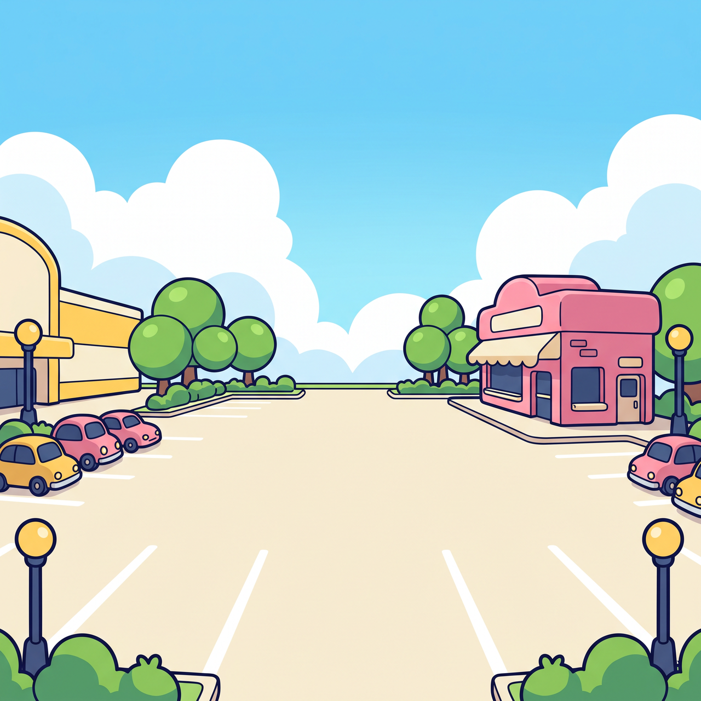
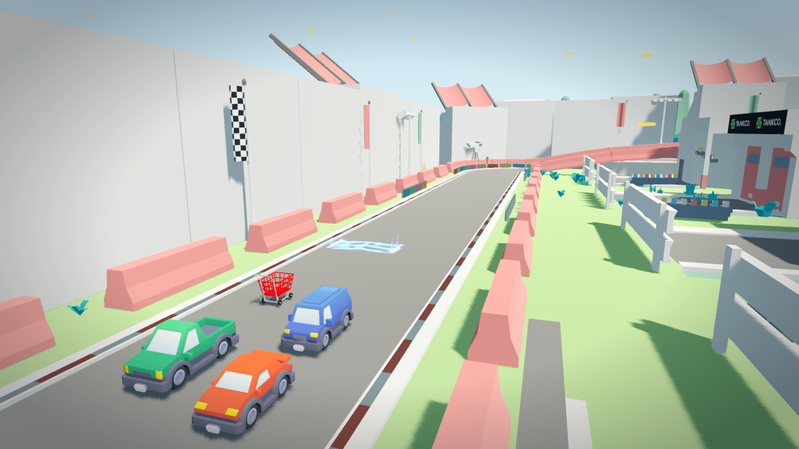
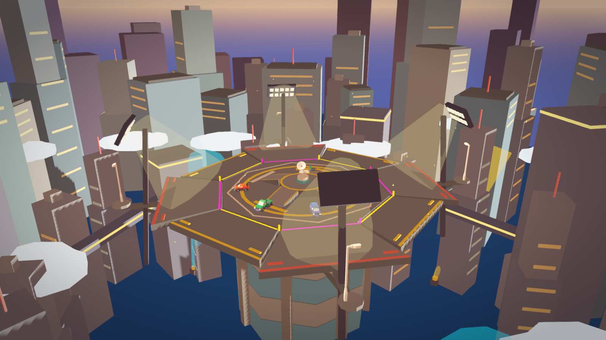
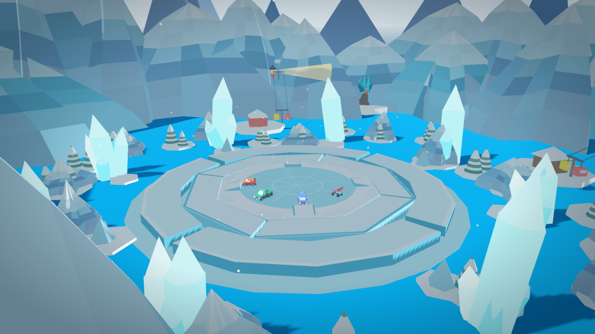
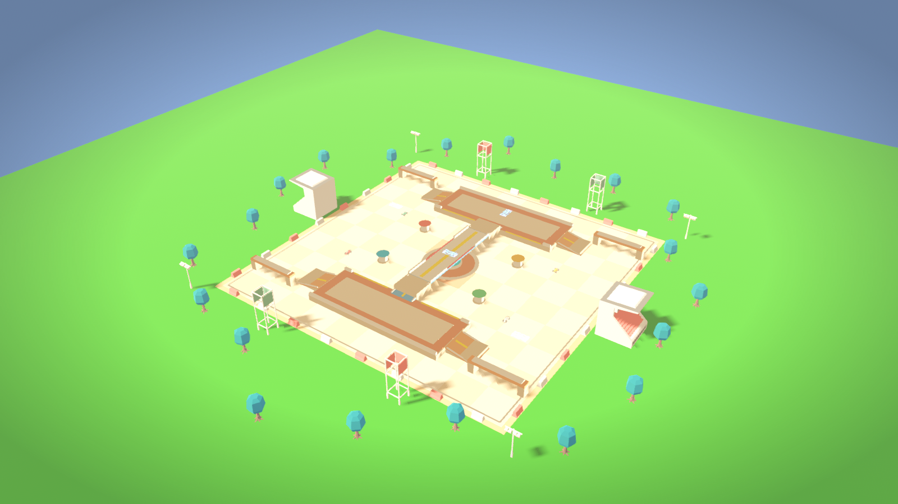
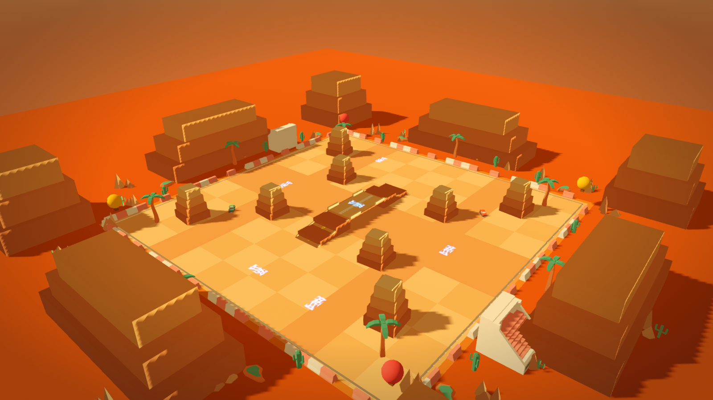
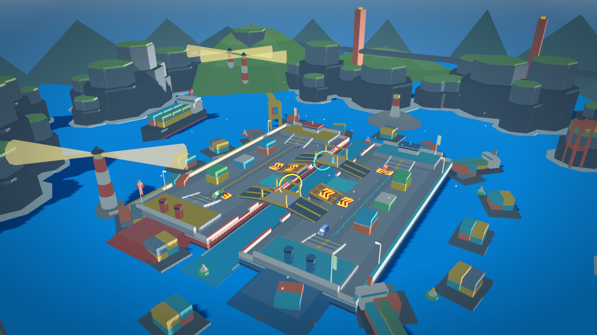
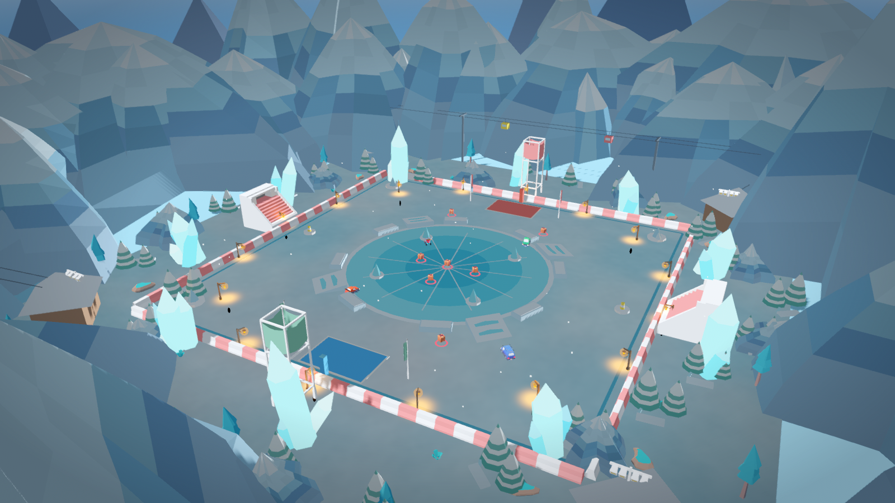
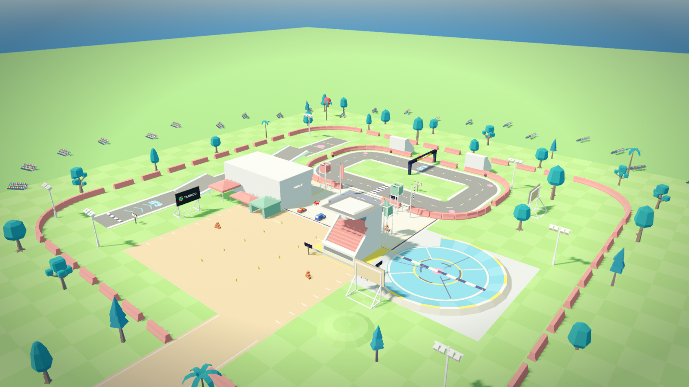

<div align="center">



# Cart Slop GP

**High-energy comic-arcade kart racing & 8-player party mayhem built with Godot 4.**
Hop-drift shopping carts and street rides across **5 vertical circuits**, brawl across **9 party arenas** in **Knockout**, **Blast Tag**, and **Deliver**, or tear up the **Stunt Park** — solo vs AI, on Wi-Fi LAN, or online with a 5-letter room code.

[](https://github.com/HOT18594/CartSlopGP/releases/latest)
[](https://godotengine.org/)
[](https://github.com/HOT18594/CartSlopGP/releases/latest)
[](LICENSE)

[**Download latest release**](https://github.com/HOT18594/CartSlopGP/releases/latest) · [**Circuits**](#5-high-verticality-racing-circuits) · [**Party Modes**](#3-party-modes--9-unique-3d-arenas) · [**Controls**](#controls) · [**Multiplayer**](#multiplayer-online--lan) · [**Build from Source**](#build-from-source)

</div>

---

## Highlights in v0.8.1

- **Fixed & Enhanced Maps** — The Sandbox park has real ground, paint and shadows again and a richer stunt-park look; every party arena's themed surround is now built for its own ground, water and height (city skyline under Skytop Helipad, lava-sea stacks in Molten Foundry, ice floes in Fractured Iceberg, harbour barges at Twin Ferries); circuit vistas and preview renders are polished across all 18 cards.
- **Factory Liveries Only** — Per-player vehicle paint tinting is gone; every cart, van and truck keeps the livery it ships with, in every mode and on every peer. The Garage keeps its 12-point stat tuning.
- **Sharper Driving** — More high-speed steering authority, a smoother counter-steer return and stronger braking bite that kills a slide.
- **Bots That Recover** — Racing bots detect walls at crawl speed, reverse out sooner with an alternating escape line, never stay pinned behind traffic, and re-align gently instead of spearing the same corner again.
- **New Menu Art & Changelog Images** — New low-angle sandbox and helipad hero renders power the main-menu slideshow, and release notes now show scene images in-game.

---

## 5 High-Verticality Racing Circuits

Every circuit is a watertight closed 3D loop built from modular geometry with bridges, elevation climbs, surface grip zones, and AI racing lines.

| **Stadium Circuit** (`857 m` · `9.0 m` climb) | **Redwood Valley** (`890 m` · `9.0 m` climb) |
| :---: | :---: |
|  |  |
| Grandstand bowl, viaduct crossover, and fast S-bends. | Twin ridge climbs, timber bridges, and forest sweepers. |

| **Sunset Canyon** (`987 m` · `12.0 m` climb) | **Dockyard Quay** (`889 m` · `7.5 m` climb) | **Glacier Pass** (`1,050 m` · `13.5 m` climb) |
| :---: | :---: | :---: |
|  |  |  |
| Terraced red-rock mesas, sandstone arches, and a palm oasis. | Raised container wharf, crane gantries, and slick wet lanes. | High alpine switchbacks, low-grip ice sectors, and a summit drop. |

---

## 3 Party Modes · 9 Unique 3D Arenas

<p align="center">
  
</p>

### 1. Knockout — Bumper Royale
Hits build Smash-style **Knockback % (`0%–250%`)** — the higher your percentage, the further each impact launches you! Trigger **Power-Slam Surge** (`E` / `F` / Right Mouse / Gamepad `B`) for shockwave knockbacks while outer stage sectors flash red and drop into the abyss.

| **Skytop Helipad** | **Molten Foundry** | **Fractured Iceberg** |
| :---: | :---: | :---: |
|  |  |  |
| Octagonal skyscraper helipad with 8 collapsing outer deck plates. | Crucible platform over molten lava with catwalks and collapsing grates. | Low-grip arctic floe surrounded by calving outer ice shelves. |

### 2. Blast Tag — Hot-Potato Chase
One cart spawns carrying a ticking **Mega-Bomb** overhead (`+18%` **Carrier Panic Overdrive** speed). Ram any rival to pass the bomb and earn a `1.8 s` **Cyan Immunity Shield**; runners fire **Juke Surge** smoke dodges to break ankles before `0.0 s` triggers a massive detonation shockwave!

| **Terrace Plaza** | **Canyon Labyrinth** | **Twin Ferries** |
| :---: | :---: | :---: |
|  |  |  |
| Multi-tier urban plaza with central jump crown and corner ramps. | Sandstone ruins with sightline blockers and raised bridge cutoffs. | Two cargo decks separated by open water and 3 narrow jump gangways. |

### 3. Deliver — 2-Team Cargo Rush
Blue vs Red crate heist! Snatch golden supply crates (`0.45 s` quick-load) from contested high ground and race them back to your team's drop zone before the `120 s` horn sounds.

| **Harbour Overpass** | **Windmill Hills** | **Glacier Bowl** |
| :---: | :---: | :---: |
|  |  |  |
| `+2.2 m` central steel bridge spanning twin harbour water channels. | `+2.0 m` windmill plateau flanked by mud trenches and plank bridges. | Sunken slick-ice crater ringed by snow-berm jump kickers. |

### Sandbox — SlopMart Stunt Park
| **`144 × 144 m` Open Stunt Park** | **What's Inside** |
| :---: | :--- |
|  | Free-roam playground with a real grass-and-tarmac facility: painted **Handling Loop**, twin stunt kickers, a banked `16°` **Drift Bowl**, raised terrace and pit garages, **Speed-Up Aurora** boost strips, traffic cones, dirt slalom and smashable crate pyramids. Swap between any of the 7 vehicles on the fly. |

---

## Download and Play

Grab the latest self-contained release from the [**Releases page**](https://github.com/HOT18594/CartSlopGP/releases/latest) — no installer and no account required.

| Platform | Package | How to Run |
| :--- | :--- | :--- |
| **Windows** (x64) | `CartSlopGP_v0.8.1_windows.zip` | Extract and run `CartSlopGP.exe` (single self-contained executable with embedded data pack). If SmartScreen warns on unsigned builds: **More info → Run anyway**. |
| **macOS** (Universal) | `CartSlopGP_v0.8.1_macos.zip` | Extract and open `Cart Slop GP.app`. If Gatekeeper blocks the ad-hoc build, right-click **Open** or run `xattr -dr com.apple.quarantine "/path/to/Cart Slop GP.app"`. |
| **Linux** (x86_64) | `CartSlopGP_v0.8.1_linux.zip` | Extract and run `./CartSlopGP.x86_64` (`0755` executable bit preserved in zip; data pack embedded). |
| **Web** (HTML5) | `CartSlopGP_v0.8.1_web.zip` | Serve over HTTP (e.g. `python3 -m http.server 8000`) and open in a modern browser. Solo modes only (browsers lack raw UDP sockets). |

### Automatic Updates & Save Data
Desktop builds check for new releases automatically (or via **SETTINGS → CHECK FOR UPDATES**), verify the download's **SHA-256** digest, swap the binary in place, and relaunch with one click. Local settings and lap records are stored in:
- **Windows:** `%APPDATA%/Godot/app_userdata/Cart Slop GP/`
- **macOS:** `~/Library/Application Support/Godot/app_userdata/Cart Slop GP/`
- **Linux:** `~/.local/share/godot/app_userdata/Cart Slop GP/`

---

## Controls

Keyboard (WASD, one-hand Arrow cluster, or Mouse) and Gamepad work seamlessly across every mode and menu.

| Action | Keyboard / Mouse | Gamepad |
| :--- | :--- | :--- |
| **Accelerate** | `W` / `Up` | Right Trigger (`R2` / `RT`) |
| **Brake / Reverse** | `S` / `Down` | Left Trigger (`L2` / `LT`) |
| **Steer** | `A` / `D` or `Left` / `Right` | Left Stick |
| **Hop + Drift** | `Space` or `,` (hold to charge `SPARK` → `BLAZE` → `ULTRA!`) | `A` / Cross |
| **Boost** | `Shift`, `Left Mouse`, or `.` | `X` / Square |
| **Action / Surge** *(Crate Load · Power-Slam · Juke)* | `E`, `F`, or `Right Mouse` | `B` / Circle |
| **Horn** | `H` | Right Bumper (`R1` / `RB`) |
| **Reset Cart** | `R` or `/` | `Y` / Triangle |
| **Scoreboard / Ping** *(hold)* | `Tab` | Select / View |
| **Pause / Menu** | `Esc` | Start / Menu |

---

## Vehicles

All **7 road vehicles** (plus the 4 race-kit cars on circuits) keep their factory livery. Racing Garage builds spend **12 upgrade points** across speed, acceleration, handling and weight before races:

| Vehicle | Mass | Base Top Speed | Driving Character |
| :--- | :---: | :---: | :--- |
| **Shopping Cart** | `45 kg` | `19 m/s` | Featherweight wire frame, instant launch, caster rattle, razor-sharp hop-drifts |
| **Sedan** | `1.35 t` | `23 m/s` | Predictable, balanced all-rounder |
| **Sports Car** | `1.15 t` | `27 m/s` | Highest top speed, planted grip, screaming 4-gear note |
| **Taxi** | `1.45 t` | `22 m/s` | Nimble city cab with lively rear rotation |
| **Van** | `2.05 t` | `20 m/s` | Heavy momentum carrier with wide skid tracks |
| **Box Truck** | `3.20 t` | `18 m/s` | Juggernaut mass — shrugs off bumps and sends lighter carts flying |
| **Police Cruiser** | `1.55 t` | `25 m/s` | Fast pursuit V8 with strong mid-range pull |

---

## Multiplayer (Online & LAN)

Open **PLAY → MULTIPLAYER**, customize your driver name and tag colour, and connect **up to 8 players** (plus optional AI bots):

1. **Online Room (5-Letter Code)** — Press **CREATE ONLINE ROOM** to open an outbound relay tunnel (zero port forwarding required) and share your 5-letter room code (e.g. `SLOPZ`), or toggle the room public so friends can join from **BROWSE ROOMS**.
2. **Same Wi-Fi / LAN** — Press **CREATE LAN ROOM** for zero-internet local play; friends on the same network discover the room automatically under **BROWSE ROOMS**.
3. **Full Mode & Arena Picker** — Inside the 2-column room lobby, the host can switch freely between **Racing**, **Knockout**, **Blast Tag**, **Deliver**, and **Sandbox**, preview all **15 maps** with live screenshots, configure bot count or team assignments, and launch straight into the match.

---

## Build from Source

Requires [**Godot Engine 4.7.2**](https://godotengine.org/download/) (standard GDScript build) with 4.7.2 export templates installed.

```bash
git clone https://github.com/HOT18594/CartSlopGP.git
cd CartSlopGP

# Headless boot check
godot --headless --path . --quit

# Open in the Godot editor (or press F5 to play)
godot --editor --path .
```

### Repository Structure

```text
scenes/
  ui/          Centered comic-arcade menus, Garage, 2-column lobby & HUD
  minigames/   Racing circuits, Knockout, Blast Tag & Deliver scenes
  player/      Kart controller, chase camera & boost feedback rigs
  track/       Holographic Speed-Up Aurora boost pad prefab
scripts/
  minigames/   Spline/grid circuit builder, 5 track themes & 3 party modes
  vehicles/    7-vehicle catalog, procedural 4-gear audio & toon visuals
  ui/          Slop-Slash custom-drawn HUD gauges, parallelogram bars & cards
  net/         ENet LAN + UDP relay tunnel client & authoritative clock sync
  systems/     Settings, scene loader & SHA-256 verified self-updater
assets/        CC0/open models, PBR surfaces, shaders, audio, fonts & 18 map renders
```

---

## Credits & License

- **Engine:** [Godot Engine 4.7.2](https://godotengine.org/) (MIT)
- **3D Kits & Surfaces:** Kenney *Car Kit*, *Racing Kit*, and *Nature Kit* (CC0), Poly Pizza go-kart & shopping-cart models, and Poly Haven PBR textures & foliage (CC0)
- **Audio:** Kenney *Impact*, *Digital Audio*, and *Interface* packs (CC0), OpenGameArt CC0 engine/horn samples, and procedural synth layers
- **Typography & UI:** *Luckiest Guy* (Apache 2.0), *Fredoka* (SIL OFL 1.1), and Kenney *Cursor Pack* (CC0)

Full asset attributions are listed in [CREDITS.md](CREDITS.md). Source code is licensed under the [MIT License](LICENSE); third-party assets retain their respective licenses as documented in [CREDITS.md](CREDITS.md).
