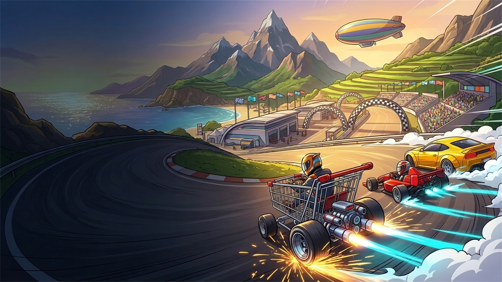
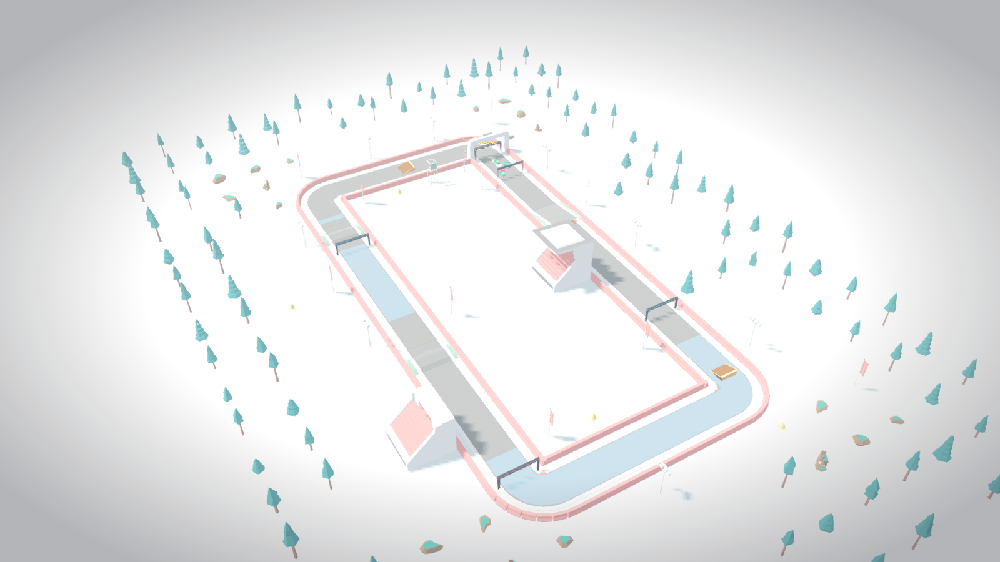
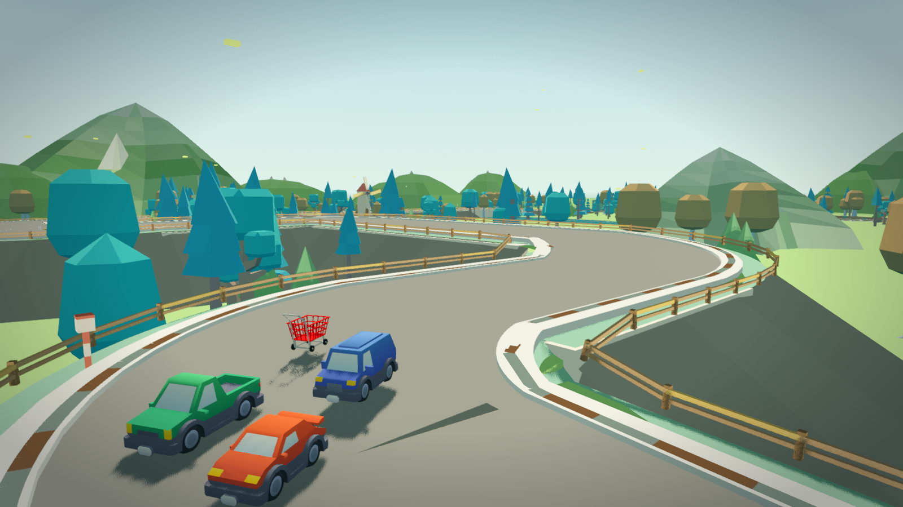
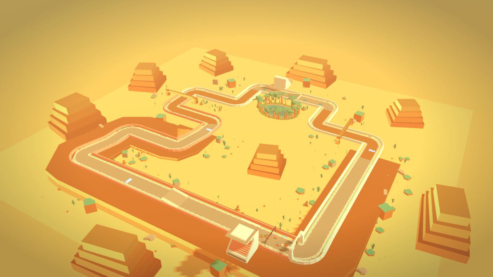
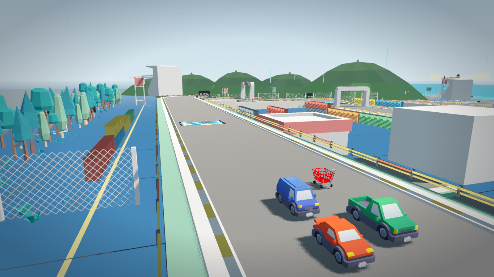
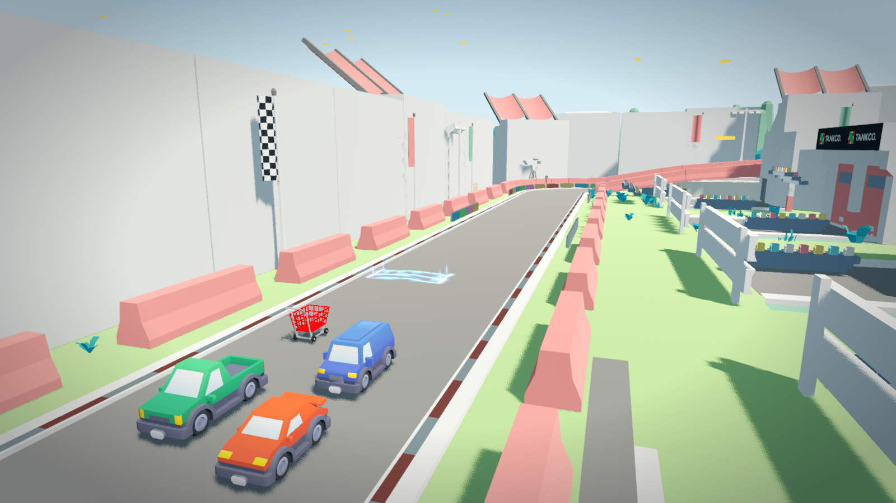
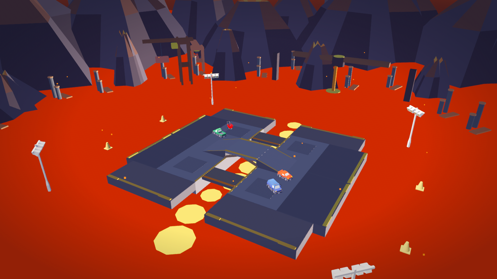
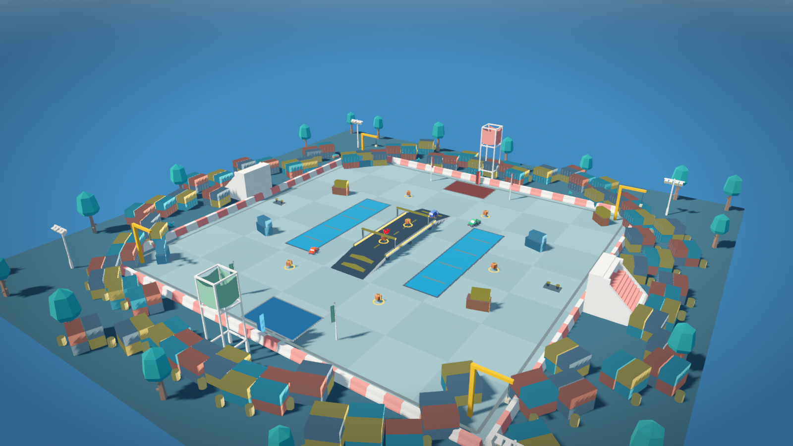
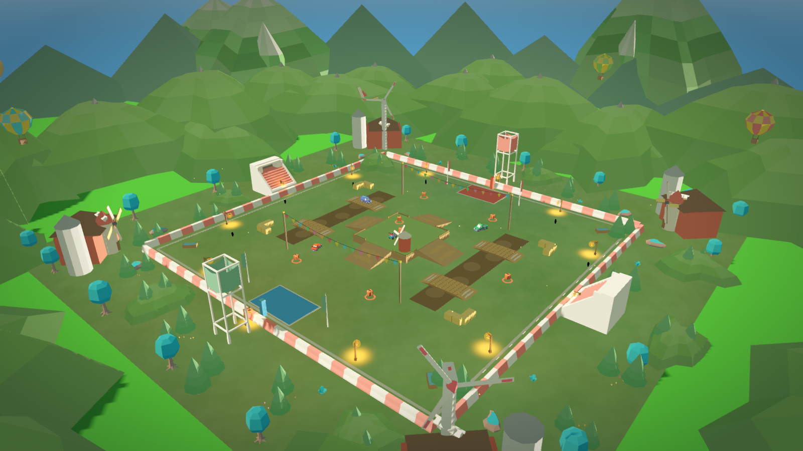

<div align="center">



# Cart Slop GP

**High-energy comic-arcade kart racing & 8-player party mayhem built with Godot 4.**
Hop-drift a twin-thruster Hero Shopping Cart or custom-painted Pro Racer across **5 living vertical circuits**, brawl across **9 party arenas** in **Knockout**, **Blast Tag**, and **Deliver**, or tear up the **SlopMart Stunt Park** — solo vs AI, on Wi-Fi LAN, or online with a 5-letter room code.

[](https://github.com/HOT18594/CartSlopGP/releases/latest)
[](https://godotengine.org/)
[](https://github.com/HOT18594/CartSlopGP/releases/latest)
[](LICENSE)

[**Download latest release**](https://github.com/HOT18594/CartSlopGP/releases/latest) · [**Circuits**](#5-high-verticality-racing-circuits) · [**Party Modes**](#3-party-modes--9-unique-3d-arenas) · [**Controls**](#controls) · [**Multiplayer**](#multiplayer-online--lan) · [**Build from Source**](#build-from-source)

</div>

---

## Highlights in v0.8.7 — LAN Latency Fix, Authoritative Leaderboards, Cartoon Feel, Living Worlds & Browser Overhaul



- **Same-LAN ping slashed from 50-70 ms to 6-7 ms** — online rooms now connect **directly** between LAN peers instead of relaying every packet through the Pi (3 s direct probe with silent relay fallback), the Cloudflare WARP/public-relay hairpin is fixed, TCP_NODELAY is actually applied to the host tunnel (it was silently rejected), every live probe/stream rides one persistent HTTP keep-alive connection, and **Pi server 1.9.0** removes a relay-budget bug that was dropping ~13% of datagrams at normal load. Forced-relay LAN ping measures ~27-34 ms; relay RTT p95 is 10.86 ms.
- **One authoritative leaderboard — no more different final standings** — the host now broadcasts revisioned, deterministic final standings to every client; finishes are reported on a reliable channel so a race can no longer stall on "WAITING FOR 1 PLAYER", close finishes are RTT-compensated instead of packet-arrival ordered, tied knockout/HUD orders are deterministic, and car selection / paint / tune / `PICK OWN`-`SHARED` policy resync when each player enters the match.
- **Cartoon vehicle feel & accurate physics** — fixed the Glacier Pass ramp collider (it was 0.68 m against a 2.82 m visible kicker, so karts drove through the top of the jump), fixed the inside-out Stadium Circuit grandstands, removed the residual vehicle hover (up to 142 mm on the race car), audited every map's geometry/colliders and hitboxes, and added squash-and-stretch, body roll, landing compression and springy suspension flex for **your cart and every remote cart** — purely visual, no extra netcode.
- **Living worlds & expressive effects** — 7 themed layered GPU ambient systems (blizzard, dust, chaff, embers, sea mist, confetti, leaves) with wind, turbulence and performance tiers; per-car tyre/drift marks with unique tread widths/styles, seven surface palettes and **one draw per cart** (remote carts included); subtle main-menu particles; and a three-deck music engine with equal-power crossfades so audio never hard-cuts.
- **Browser builds that stay current, lean and branded** — a dedicated **Web Low-Spec** profile (auto-detected: 0.5× render scale, 30 fps, ETC2-only textures, no MSAA/shadows, 1600×900 canvas cap) and a Cloudflare **R2 + CDN Worker** package bring first-load transfer to **111 MB gzip / 106.5 MB Brotli** (−33 %) with immutable caching and Brotli/Gzip negotiation while the Pi stays dedicated to relay/API. Every web export is stamped with `version.json`, and the build/stage/deploy/`/play` paths refuse or flag a stale client — plus a new official-branding website and logo parity across `/play`, login and console pages.
- **Main menu gains MAPMAKER & living backdrops** — the rail is now **`SINGLEPLAYER` → `MULTIPLAYER` → `MAPMAKER` → `GARAGE`**. `MAPMAKER` is a padlocked greyed teaser that opens a slanted **`COMING SOON :D`** dialog with a single confetti burst, and menu/lobby backdrops are now independent shuffled slideshows (random 8-12 s beat, smooth crossfades, no back-to-back repeats) that mouse hover/focus can no longer disturb.
- **Lobby, end screens, bot slots and caret polish** — the lobby map preview is a black-slanted card with subtle 3D-like sway, emotes are now chrome-free bold coloured text + a small sender name (random spawn, wiggle up, fade out, fully synced), host/guest end screens are split cleanly (hosts keep lobby controls; guests get an animated `Waiting for host...` + a confirmed `LEAVE LOBBY`), bots occupy real 8-slot lobby seats as **`BOT 1…5`** with a robot icon, host-movable teams and Auto-Arrange parity across peers, and every text field has a visible 0.5 s high-contrast caret.
- **100% black slanted UI, including all four multiplayer end screens** — shared `UiKit`/`SlantedShell` primitives replace duplicated hand-painted shells, legacy cream/rounded theme fallbacks are removed, and every game-end card (Racing, Knockout, Deliver, Blast Tag) is rebuilt on one `ResultScreen` builder with scrolling standings capped to the 720p safe box, a uniform button matrix and a closed keyboard/gamepad focus ring.
- **Bug fixes across all three passes** — multiplayer **RACE AGAIN / PLAY AGAIN** now really restarts the match on every peer in all four modes, `settings.cfg` saves atomically (power-loss safe), gamepad can open the scoreboard (Select/View), Web builds hide dead MULTIPLAYER/QUIT/UPDATE paths, solo play auto-pauses on focus loss, late joiners receive the final standings, version-gated joins reject mismatched builds, and host-loss/host-disconnect now shows a **HOST DISCONNECTED** overlay instead of dumping everyone to a fresh lobby.
- **Server v2.0.0 prepared (not deployed)** — repository server source now has compact/cached APIs, a Health admin tab, `/play` Range/resume delivery, capacity-aware room admission (bots occupy seats), and a corrected TLS relay pump, wire-compatible with all 0.8.x clients.

> **Quality-of-life roadmap:** the prioritised backlog from this audit lives in [`docs/QOL_RECOMMENDATIONS.md`](docs/QOL_RECOMMENDATIONS.md).
---

## 5 High-Verticality Racing Circuits

Every circuit is a watertight closed 3D loop built from modular geometry with bridges, elevation climbs, surface grip zones, and AI racing lines.

| **Stadium Circuit** (`857 m` · `9.0 m` climb) | **Redwood Valley** (`890 m` · `9.0 m` climb) |
| :---: | :---: |
|  |  |
| Grandstand bowl, viaduct crossover, and fast S-bends. | Twin ridge climbs, timber bridges, and forest sweepers. |

| **Sunset Canyon** (`987 m` · `12.0 m` climb) | **Dockyard Quay** (`889 m` · `7.5 m` climb) | **Glacier Pass** (`1,050 m` · `13.5 m` climb) |
| :---: | :---: | :---: |
|  |  |  |
| Terraced red-rock mesas, sandstone arches, and a palm oasis. | Raised container wharf, crane gantries, and slick wet lanes. | High alpine switchbacks, low-grip ice sectors, and a summit drop. |

---

## 3 Party Modes · 9 Unique 3D Arenas

<p align="center">
  
</p>

### 1. Knockout — Bumper Royale
Hits build Smash-style **Knockback % (`0%–250%`)** — the higher your percentage, the further each impact launches you! Trigger **Power-Slam Surge** (`E` / `F` / Right Mouse / Gamepad `B`) for shockwave knockbacks while outer stage sectors flash red and drop into the abyss.

| **Skytop Helipad** | **Molten Foundry** | **Fractured Iceberg** |
| :---: | :---: | :---: |
|  |  |  |
| Octagonal skyscraper helipad with 8 collapsing outer deck plates. | Crucible platform over molten lava with catwalks and collapsing grates. | Low-grip arctic floe surrounded by calving outer ice shelves. |

### 2. Blast Tag — Hot-Potato Chase
One cart spawns carrying a ticking **Mega-Bomb** overhead (`+18%` **Carrier Panic Overdrive** speed). Ram any rival to pass the bomb and earn a `1.8 s` **Cyan Immunity Shield**; runners fire **Juke Surge** smoke dodges to break ankles before `0.0 s` triggers a massive detonation shockwave!

| **Terrace Plaza** | **Canyon Labyrinth** | **Twin Ferries** |
| :---: | :---: | :---: |
|  |  |  |
| Multi-tier urban plaza with central jump crown and corner ramps. | Sandstone ruins with sightline blockers and raised bridge cutoffs. | Two cargo decks separated by open water and 3 narrow jump gangways. |

### 3. Deliver — 2-Team Cargo Rush
Blue vs Red crate heist! Snatch golden supply crates (`0.45 s` quick-load) from contested high ground and race them back to your team's drop zone before the `120 s` horn sounds.

| **Harbour Overpass** | **Windmill Hills** | **Glacier Bowl** |
| :---: | :---: | :---: |
|  |  |  |
| `+2.2 m` central steel bridge spanning twin harbour water channels. | `+2.0 m` windmill plateau flanked by mud trenches and plank bridges. | Sunken slick-ice crater ringed by snow-berm jump kickers. |

### Sandbox — SlopMart Stunt Park
| **`144 × 144 m` Open Stunt Park** | **What's Inside** |
| :---: | :--- |
|  | Free-roam playground with a real grass-and-tarmac facility: painted **Handling Loop**, twin stunt kickers, a banked `16°` **Drift Bowl**, raised terrace and pit garages, **Speed-Up Aurora** boost strips, traffic cones, dirt slalom and smashable crate pyramids. Swap between any of the 7 vehicles on the fly. |

---

## Download and Play

Grab the latest self-contained release from the [**Releases page**](https://github.com/HOT18594/CartSlopGP/releases/latest) — no installer and no account required.

| Platform | Package | How to Run |
| :--- | :--- | :--- |
| **Windows** (x64) | `CartSlopGP_v0.8.7_windows.zip` | Extract and run `CartSlopGP.exe` (single self-contained executable with embedded data pack). If SmartScreen warns on unsigned builds: **More info → Run anyway**. |
| **macOS** (Universal) | `CartSlopGP_v0.8.7_macos.zip` | Extract and open `Cart Slop GP.app`. If Gatekeeper blocks the ad-hoc build, right-click **Open** or run `xattr -dr com.apple.quarantine "/path/to/Cart Slop GP.app"`. **LAN multiplayer:** on first launch macOS 14/15 asks to allow **Local Network** access — click **Allow** (if you missed it: **System Settings → Privacy & Security → Local Network**). Without that permission macOS silently blocks LAN discovery and LAN joins. |
| **Linux** (x86_64) | `CartSlopGP_v0.8.7_linux.zip` | Extract and run `./CartSlopGP.x86_64` (`0755` executable bit preserved in zip; data pack embedded). |
| **Web** (HTML5) | `CartSlopGP_v0.8.7_web.zip` | Serve over HTTP (e.g. `python3 -m http.server 8000`) and open in a modern browser. Solo modes only (browsers lack raw UDP sockets). |

### Automatic Updates & Save Data
Desktop builds check for new releases automatically (or via **SETTINGS → CHECK FOR UPDATES**), verify the download's **SHA-256** digest, swap the binary in place, and relaunch with one click. Local settings and lap records are stored in:
- **Windows:** `%APPDATA%/Godot/app_userdata/Cart Slop GP/`
- **macOS:** `~/Library/Application Support/Godot/app_userdata/Cart Slop GP/`
- **Linux:** `~/.local/share/godot/app_userdata/Cart Slop GP/`

---

## Controls

Keyboard (WASD, one-hand Arrow cluster, or Mouse) and Gamepad work seamlessly across every mode and menu.

| Action | Keyboard / Mouse | Gamepad |
| :--- | :--- | :--- |
| **Accelerate** | `W` / `Up` | Right Trigger (`R2` / `RT`) |
| **Brake / Reverse** | `S` / `Down` | Left Trigger (`L2` / `LT`) |
| **Steer** | `A` / `D` or `Left` / `Right` | Left Stick |
| **Hop + Drift** | `Space` or `,` (hold to charge `SPARK` → `BLAZE` → `ULTRA!`) | `A` / Cross |
| **Boost** | `Shift`, `Left Mouse`, or `.` | `X` / Square |
| **Action / Surge** *(Crate Load · Power-Slam · Juke)* | `E`, `F`, or `Right Mouse` | `B` / Circle |
| **Horn** | `H` | Right Bumper (`R1` / `RB`) |
| **Reset Cart** | `R` or `/` | `Y` / Triangle |
| **Scoreboard / Ping** *(hold)* | `Tab` | Select / View |
| **Lobby reaction** *(in room)* | `1`–`5` | D-pad + `A` on the reaction strip |
| **Pause / Menu** | `Esc` | Start / Menu |

---

## Vehicles

All **7 road vehicles** (plus the 4 race-kit cars on circuits) keep their factory livery. Racing Garage builds spend **12 upgrade points** across speed, acceleration, handling and weight before races:

| Vehicle | Mass | Base Top Speed | Driving Character |
| :--- | :---: | :---: | :--- |
| **Shopping Cart** | `45 kg` | `19 m/s` | Featherweight wire frame, instant launch, caster rattle, razor-sharp hop-drifts |
| **Sedan** | `1.35 t` | `23 m/s` | Predictable, balanced all-rounder |
| **Sports Car** | `1.15 t` | `27 m/s` | Highest top speed, planted grip, screaming 4-gear note |
| **Taxi** | `1.45 t` | `22 m/s` | Nimble city cab with lively rear rotation |
| **Van** | `2.05 t` | `20 m/s` | Heavy momentum carrier with wide skid tracks |
| **Box Truck** | `3.20 t` | `18 m/s` | Juggernaut mass — shrugs off bumps and sends lighter carts flying |
| **Police Cruiser** | `1.55 t` | `25 m/s` | Fast pursuit V8 with strong mid-range pull |

---

## Multiplayer (Online & LAN)

Open **PLAY → MULTIPLAYER**, customize your driver name and tag colour, and connect **up to 8 players** (plus optional AI bots):

1. **Online Room (5-Letter Code)** — Press **CREATE ONLINE ROOM** to open an outbound relay tunnel (zero port forwarding required) and share your 5-letter room code (e.g. `SLOPZ`), or toggle the room public so friends can join from **BROWSE ROOMS**.
2. **Same Wi-Fi / LAN** — Press **CREATE LAN ROOM** for zero-internet local play; friends on the same network discover the room automatically under **BROWSE ROOMS**.
3. **Full Mode & Arena Picker** — Inside the 2-column room lobby, the host can switch freely between **Racing**, **Knockout**, **Blast Tag**, **Deliver**, and **Sandbox**, preview all **15 maps** with live screenshots, configure bot count or team assignments, and launch straight into the match.
4. **Lobby Reactions & Ready Gate** — While waiting, everyone can spam one of five synced reactions (`GG!`, `START!`, `LOVE`, `SLOP!`, `HONK!`) with mouse, keys **1–5** or gamepad; each one pops up as bold coloured text with the sender's name, floats up with a playful wiggle and fades out (no boxes, no bars), and is rate-limited. The host also gets a ready/presence gate (WAITING / AWAY / START ANYWAY) so a match can't launch while a player is still in the garage or loading.
5. **Bots Occupy Real Seats** — the 8 lobby seats are shared between humans and bots: with 3 bots, only 5 humans can join (enforced by the host and the room server, with a clear "room is full" reason). Bots appear in the roster as **`BOT 1…5`** with a robot icon, can be moved between ALPHA/BETA by the host exactly like humans, and Auto-Arrange balances everyone across teams live on every player's screen.

**Bots with a brain.** Set Easy, Normal, or Hard per room: hunters intercept, runners juke, rivals defend lines and boost jump ramps — all in the same karts with the same rules as you.

---

## Build from Source

Requires [**Godot Engine 4.7.2**](https://godotengine.org/download/) (standard GDScript build) with 4.7.2 export templates installed.

```bash
git clone https://github.com/HOT18594/CartSlopGP.git
cd CartSlopGP

# Headless boot check
godot --headless --path . --quit

# Open in the Godot editor (or press F5 to play)
godot --editor --path .
```

### Repository Structure

```text
scenes/
  ui/          Centered comic-arcade menus, Garage, 2-column lobby & HUD
  minigames/   Racing circuits, Knockout, Blast Tag & Deliver scenes
  player/      Kart controller, chase camera & boost feedback rigs
  track/       Holographic Speed-Up Aurora boost pad prefab
scripts/
  minigames/   Spline/grid circuit builder, 5 track themes & 3 party modes
  vehicles/    7-vehicle catalog, procedural 4-gear audio & toon visuals
  effects/     Layered GPU ambient systems, FX quality tiers & budget probes
  feedback/    Per-car batched drift marks, skid audio & impact feedback
  ui/          Slop-Slash custom-drawn HUD gauges, parallelogram bars & cards
  net/         ENet LAN + UDP relay tunnel client, authoritative clock sync & standings
  systems/     Settings (atomic save), scene loader & SHA-256 verified self-updater
assets/        CC0/open models, PBR surfaces, shaders, audio, fonts & 18 map renders
```

---

## Website & Web Hosting

- **Website:** the static marketing site is served from [`docs/`](docs/) and
  published to GitHub Pages (classic `docs/` folder deployment) →
  **https://hot18594.github.io/CartSlopGP/**. Brand assets (favicons, app icons,
  OpenGraph/Twitter images) are generated reproducibly from the official game art
  with `python docs/tools/build_brand_assets.py` (add `--check` to verify).
- **Browser client hosting:** the Godot Web export is delivered from Cloudflare
  **R2 + a CDN Worker** (Cloudflare Pages cannot host the ~121 MB data pack); the
  reference deployment package, version-parity model and manual Cloudflare/DNS
  steps are documented in [`deploy/web/`](deploy/web/). The Pi keeps the live
  relay/API/console and can serve `/play` over HTTPS as a fallback. Web exports
  are stamped with `version.json`, so a stale `/play` client is refused at build,
  stage, deploy and launcher level.

## Credits & License

- **Engine:** [Godot Engine 4.7.2](https://godotengine.org/) (MIT)
- **3D Kits & Surfaces:** Kenney *Car Kit*, *Racing Kit*, and *Nature Kit* (CC0), Poly Pizza go-kart & shopping-cart models, and Poly Haven PBR textures & foliage (CC0)
- **Audio:** Kenney *Impact*, *Digital Audio*, and *Interface* packs (CC0), OpenGameArt CC0 engine/horn samples, and procedural synth layers
- **Typography & UI:** *Luckiest Guy* (Apache 2.0), *Fredoka* (SIL OFL 1.1), and Kenney *Cursor Pack* (CC0)

Full asset attributions are listed in [CREDITS.md](CREDITS.md). Source code is licensed under the [MIT License](LICENSE); third-party assets retain their respective licenses as documented in [CREDITS.md](CREDITS.md).
