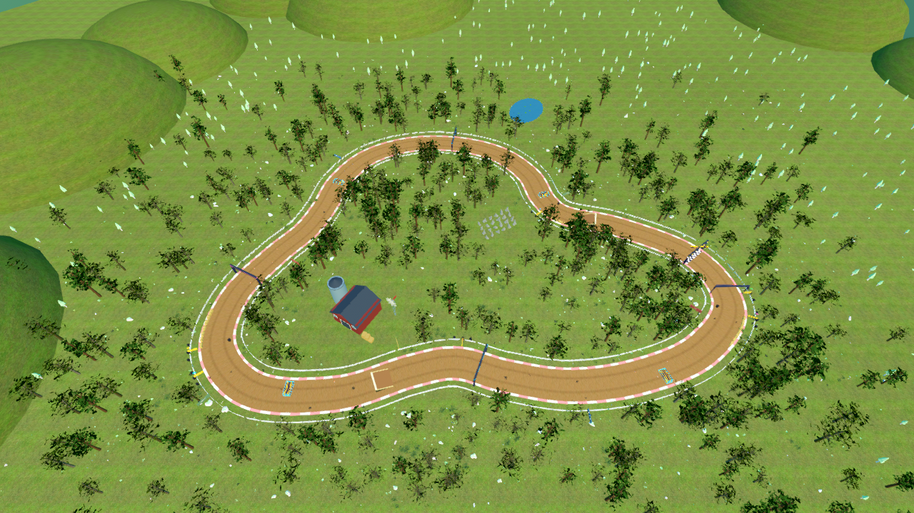

# Cart Slop GP

An arcade racing game about shopping carts. Pick a cart (or a sedan, a van, a
box truck...), drift around a playground, then race the Meadow Loop against
friends and AI rivals. Made with **Godot 4**.



## What's in the game

- **7 vehicles**, each with its own mass, top speed, engine sound, smoke and
  tyre marks: shopping cart, sedan, sports car, taxi, van, box truck and
  police cruiser.
- **Sandbox**: a 140 x 140 m arena with ramps, a drift bowl, a mesa, boost
  pads, cones, crates and speed bumps. Drift for skid marks, boost, honk and
  reset when you get stuck.
- **Meadow Loop**: three laps of a winding dirt track through a forest, with
  four boost pads, a five-lamp start gantry and up to five AI rivals.
- **Multiplayer for up to 8 players** (plus bots): host a room on your own
  network, or use a 5-letter room code through an online relay when one is
  available. The host chooses the mode, map, vehicle and bot count.
- **Settings** for audio, fullscreen, quality, HUD size, camera shake, stick
  deadzone, boost/drift toggles, reduced motion and frame rate. Gamepad and
  keyboard both work.
- **One-click updates** on Windows, macOS and Linux.
- Windows, macOS, Linux and a browser build (single player only).

## Download and play

Get the latest build from the
[**Releases page**](https://github.com/HOT18594/CartSlopGP/releases/latest).

| Platform | Download | Run |
| --- | --- | --- |
| Windows | `CartSlopGP_v0.6.8_windows.zip` | Unzip, then run `CartSlopGP.exe`. SmartScreen may warn because the build is unsigned: **More info > Run anyway**. |
| macOS | `CartSlopGP_v0.6.8_macos.zip` | Unzip, then open `Cart Slop GP.app`. If Gatekeeper blocks it, right-click the app and choose **Open**. |
| Linux | `CartSlopGP_v0.6.8_linux.zip` | Unzip, `chmod +x CartSlopGP.x86_64`, then run it. |
| Browser | `CartSlopGP_v0.6.8_web.zip` | Serve `index.html` over HTTP (a `file://` URL cannot load the data pack). Single player only. |

There is no installer and no account. Settings and downloaded updates live in
Godot's user data folder:

- Windows: `%APPDATA%/Godot/app_userdata/Cart Slop GP/`
- macOS: `~/Library/Application Support/Godot/app_userdata/Cart Slop GP/`
- Linux: `~/.local/share/godot/app_userdata/Cart Slop GP/`

The macOS build is ad-hoc signed, not notarized. If macOS says the app is
damaged, run `xattr -dr com.apple.quarantine "/path/to/Cart Slop GP.app"` once
or right-click **Open**. Do not disable Gatekeeper system-wide.

## Controls

| Action | Keyboard | Gamepad |
| --- | --- | --- |
| Accelerate | W / Up | Right trigger |
| Brake / reverse | S / Down | Left trigger |
| Steer | A / D or Left / Right | Left stick |
| Handbrake / drift | Space or `,` | A |
| Boost | Shift, Left Mouse or `.` | X |
| Horn | H | Right shoulder |
| Reset cart | R or `/` | Y |
| Player list (hold) | Tab | - |
| Pause / menu | Esc | Start |

The arrow keys plus `,` `.` `/` make a complete one-hand driving layout. Menus
are mouse, touch or gamepad; there is no keyboard cursor. H is a short,
rate-limited honk that everyone in the room hears.

In single player, Esc pauses the world. In multiplayer, Esc opens the menu but
the race keeps running. Hold Tab to see player names, tag colours and ping.

## Single player

**PLAY** offers **SINGLE** and **MULTIPLAYER**.

**SINGLE > SANDBOX** drops you into the arena with the vehicle of your choice.
The picker compares all seven vehicles with bars instead of raw numbers, and
remembers your last pick.

| Vehicle | Weight | Top speed | Character |
| --- | --- | --- | --- |
| Shopping cart | 45 kg | 19 m/s | no engine, quick, rattles, thin skids |
| Sedan | 1.35 t | 23 m/s | balanced all-rounder |
| Sports car | 1.15 t | 27 m/s | fastest, best grip, loudest skids |
| Taxi | 1.45 t | 22 m/s | rattly and slightly sluggish |
| Van | 2.05 t | 20 m/s | heavy, more smoke, wider marks |
| Box truck | 3.2 t | 18 m/s | slow to spin up, plows through props |
| Police cruiser | 1.55 t | 25 m/s | quick V8 cruiser |

Mass matters: heavier vehicles accelerate slower, lose less speed on impact and
push props further.

**SINGLE > MINIGAMES > MEADOW LOOP** is the race. Pick a vehicle, choose how
many bots (0-5), and press **RACE**. The start gantry has five lamps: they light
1, 3 and 5 on the countdown, then all five go green on GO.

## Multiplayer

**PLAY > MULTIPLAYER** opens the lobby. Set a name (up to 16 characters) and a
tag colour, then choose how to play.

### Same network

1. The host presses **HOST LAN ROOM**.
2. Everyone else presses **FIND LAN ROOMS** and picks the room from the list.
   No code, IP address or port is needed.
3. On the host, set the **ROOM** pill to PUBLIC so it appears in the list;
   private rooms stay hidden.

### Room code

1. The host presses **CREATE ONLINE ROOM**. When a relay is reachable, the
   game returns a 5-letter code such as `ABCDE`.
2. Friends press **BROWSE ONLINE ROOMS** to pick a public room, or type the
   code into **5-LETTER CODE** and press **JOIN**.
3. The host connects out to the relay, so no port forwarding is needed on the
   host machine.

Online rooms use the Cart Slop relay. LAN rooms always work without a relay.

### In the room

- The host picks **SANDBOX** or **MINIGAMES**, the map, the vehicle and the
  number of bots, then presses **START**.
- In a Meadow Loop race everyone drives the host's car; name tags tell players
  apart. Sandbox keeps each player's own vehicle.
- **COPY CODE** copies the room code. **LEAVE ROOM** returns to the lobby.
- Joining a race that has already started is refused.

## Settings and updates

**SETTINGS** covers master, music and SFX volume, fullscreen, quality, HUD
size, camera shake, stick deadzone, boost/drift assists, reduced motion, FPS
and resetting to defaults. Everything saves locally.

**CHANGELOG** shows the short player-facing notes for each release.

The game checks GitHub Releases for updates when the menu opens, and
**SETTINGS > CHECK FOR UPDATES** forces a check. The dialog shows the version,
size and notes; **DOWNLOAD UPDATE** then **RESTART & UPDATE** swaps the files
and reopens the game. Nothing is unzipped or copied by hand. If the install
folder is read-only, the dialog offers the release page instead.

## Build from source

You need [Godot 4.7.2](https://godotengine.org/download/) (standard build, not
.NET) with export templates for the platforms you want.

1. `git clone https://github.com/HOT18594/CartSlopGP.git`
2. In Godot choose **Import**, select `project.godot`, then **Import & Edit**.
3. Press **F5** to run, or use **Project > Export** with the included presets.

Headless boot check:

```bash
godot --headless --path . --quit
```

Project layout:

```
scenes/    menus, sandbox, Meadow Loop, player and HUD
scripts/   gameplay, vehicles, UI, networking and systems
assets/    models, textures, audio, fonts and UI art
```

## Credits and license

- **Engine:** Godot Engine 4.7.2 (MIT).
- **Models:** Kenney Car Kit and Nature Kit (CC0), Poly Pizza go-kart and
  shopping-cart models, Poly Haven CC0 textures and plants.
- **Audio:** Kenney Impact, Digital Audio and Interface packs (CC0), CC0
  engine loops and horn from OpenGameArt, plus synthesized engine, skid and UI
  sounds.
- **Fonts:** Fredoka (SIL OFL 1.1) and Luckiest Guy (Apache 2.0).
- **UI:** Kenney Cursor Pack (CC0).

The full attribution list is in [CREDITS.md](CREDITS.md). The game's source code
is released under the [MIT License](LICENSE); third-party assets keep their own
licenses as listed in CREDITS.md.
